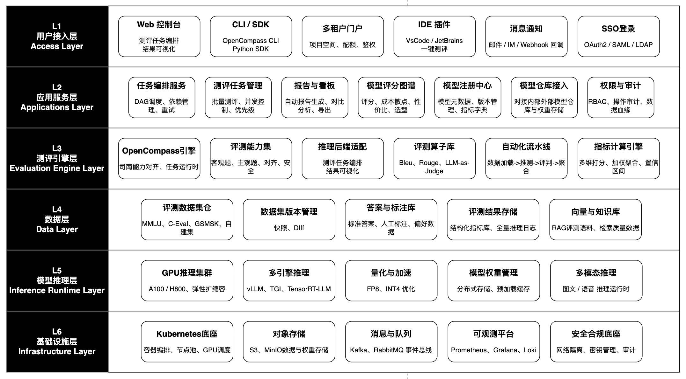
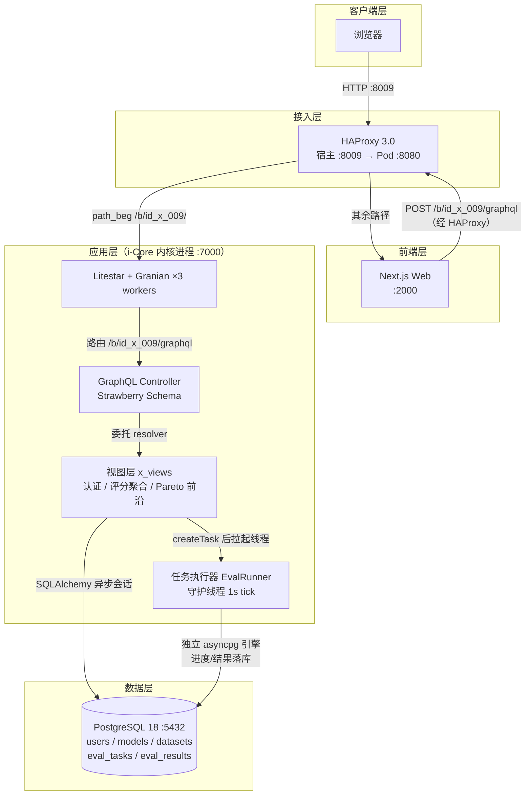
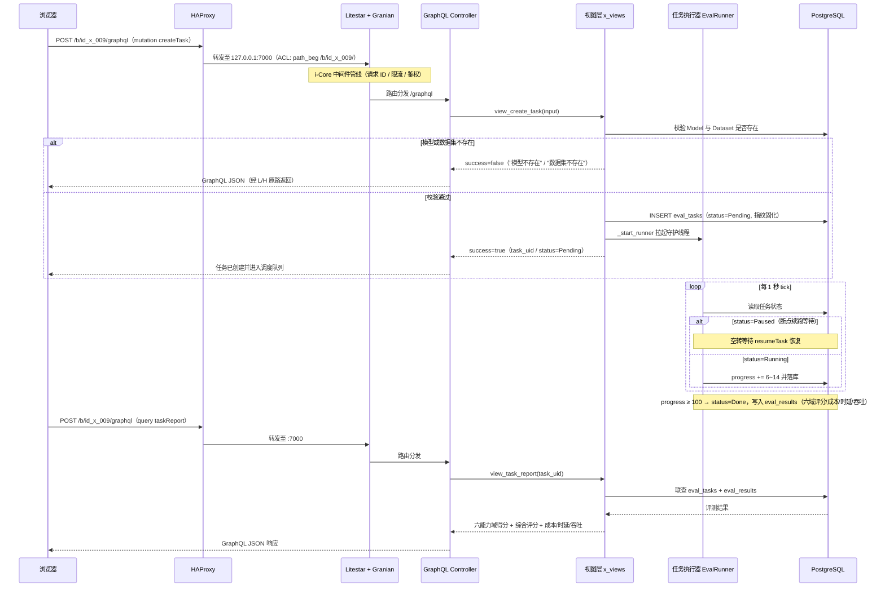

<div align="center">



# id_x_009: AI 大模型评测平台

**大模型评测、评分图谱与性价比分析一体化平台 —— 从任务调度到 Pareto 前沿，一次部署全链路闭环**


</div>

---

## 1. 简介 (Introduction)

- **Slogan**: 大模型评测、评分图谱与性价比分析一体化平台 —— 从任务调度到 Pareto 前沿，一次部署全链路闭环。
- **Description**: id_x_009 是 i-Core 平台的业务插件模块，面向大语言模型（Large Language Model, LLM）选型场景，提供模型注册、数据集管理、评测任务调度、六能力域加权评分、成本分析与「评分 × 成本」图谱可视化的完整闭环。后端以 **Litestar + Strawberry GraphQL** 暴露统一 GraphQL 端点（`/b/id_x_009/graphql`），通过 i-Core 内核的插件契约（`x_plugin.py` 实现 `PluginInterface`）完成路由挂载、建表与会话工厂注入；前端为独立的 **Next.js** 评分图谱应用。与通用评测框架（如仅输出榜单分数的工具）相比，本模块的差异在于：评测执行、六域评分聚合、成本核算与 **服务端 Pareto 前沿计算** 整合为一体，配合开箱即用的种子数据（34 个主流模型、6 个数据集、34 条已完成评测结果），首次部署即可呈现完整的评分—成本图谱与性价比排名，直接支撑「同成本选最高分、同评分选最低价」的模型选型决策。

## 2. 核心特性 (Features)

- **模型注册中心**：统一登记厂商、系列、版本、接入方式（selfhost / api / opensource）、推理后端（vllm / trtllm / tgi / api）、参数量与上下文长度，支持按厂商与接入方式过滤，同名同版本去重。
- **评测任务状态机与调度**：完整状态机 `Draft → Pending → Running → Paused → Done / Failed`，守护线程执行器每 1 秒推进进度并落库，支持暂停（断点续跑）、失败重跑与服务重启后通过 `resumeTask` 重新接管遗留任务。
- **六能力域加权评分**：客观知识与推理（30%）、语言与生成（20%）、对齐与安全（15%）、长上下文（15%）、多模态（10%）、业务专项（10%），加权聚合为综合评分，并记录每任务成本（USD）、P50 时延与生成吞吐。
- **评分—成本图谱与 Pareto 前沿**：`scoreCostGraph` 在服务端完成每模型最新结果去重、多维筛选（厂商 / 接入方式 / 后端 / 最低评分 / 最高成本）、性价比排名（评分 / 成本降序）与 Pareto 前沿点列计算（按成本升序取评分包络）。
- **可复现评测指纹**：创建任务时固化数据集快照、模型版本、推理引擎与超参（temperature / max_tokens）为 JSON 指纹，评分抖动以 `task_uid + fingerprint` 为随机种子，保证结果可复现、可追溯。
- **用户认证体系**：注册 / 登录 / 登出 / 忘记密码全流程，Bearer Token 鉴权（24 小时有效期），密码重置令牌一次性使用并自动失效旧令牌。

## 3. 项目亮点 (Highlights)

1. **服务端 Pareto 前沿计算** —— `scoreCostGraph` 直接返回按成本升序、评分刷新包络的前沿点列（`frontier`）、前沿标注（`onFrontier`）与性价比排名（`valueRank`），前端零计算即可渲染专业级「评分 × 成本」气泡图谱。
2. **可中断可恢复的任务执行器** —— 评测执行器以守护线程 + 独立 asyncpg 引擎（`pool_size=2`）运行，每秒 tick 将进度持久化到 `eval_tasks.progress`；`pauseTask` 后执行器空转等待、`resumeTask` 从断点继续，`Failed` 任务可重置重跑，`Pending` 遗留任务可在服务重启后被接管，工程可靠性形成闭环。
3. **评测结果可复现指纹** —— 指纹固化 `dataset`（版本快照，如 `mmlu-pro@2026.08:snapshot-101`）、`model`（`name@version`）、`engine` 与 `hyper` 四要素，随机数生成器以指纹为种子，同一配置多次评测结果一致。
4. **四容器 Pod 一键部署** —— HAProxy + Next.js + Litestar 服务 + PostgreSQL 18 同 Pod 共享网络命名空间，容器间经 `127.0.0.1` 通信；`./up.sh` 幂等启动（镜像缺失自动构建、容器已存在自动跳过），内置数据库与服务健康检查探针。
5. **开箱即用种子数据** —— 首次建库自动注入 34 个主流模型（覆盖 OpenAI / Anthropic / Google / DeepSeek / Alibaba / Meta / Moonshot / Zhipu / MiniMax / Mistral 十家厂商）、6 个能力域数据集、34 条已完成评测任务与结果及演示账号，评分图谱开箱即有数据。
6. **i-Core 插件化接入** —— 仅以 `x_plugin.py`（`PluginInterface`：`build_tables` / `set_session_maker`）与 `register_routers(prefix)` 两个契约接入内核，复用内核的中间件管线（请求 ID、限流、Bearer 鉴权、CORS）与数据库托管，模块零侵入、可独立演进。
7. **分层职责清晰的后端架构** —— controllers（thin resolver）/ schemas（Strawberry 类型）/ views（全部业务逻辑）/ models（SQLAlchemy ORM）四层分离，GraphQL 层不含任何业务代码，便于测试与维护。

## 4. 技术栈 (Tech Stack)

<p align="center">表 4-1 技术栈一览</p>

| 分类 | 名称 | 版本 | 用途 |
|------|------|------|------|
| 编程语言 | Python | ≥ 3.10 | 后端服务实现 |
| 编程语言 | TypeScript | ^5 | 前端开发 |
| Web 框架 | Litestar | litestar[all] | 异步 ASGI 框架与路由挂载 |
| ASGI 服务器 | Granian | — | 生产 3 workers 进程托管（:7000） |
| API 规范 | Strawberry GraphQL | — | GraphQL Schema / Query / Mutation |
| ORM / 数据访问 | SQLAlchemy + Advanced Alchemy | 2.x | 异步 ORM 与会话工厂 |
| 数据库 | PostgreSQL（asyncpg / psycopg2） | 18 | 持久化存储与种子数据初始化 |
| 前端框架 | Next.js（App Router） | 16.2.3 | 评分图谱前端（:2000） |
| UI 组件 | HeroUI（@heroui/react） | ^3.2.2 | React 组件库 |
| 动画 | Framer Motion | ^12.42.2 | 页面过渡与交互动画 |
| 样式 | Tailwind CSS | ^4 | 原子化 CSS |
| 反向代理 | HAProxy | 3.0 | Pod 内流量分发（:8080，宿主 :8009） |
| 容器引擎 | Podman | ≥ 4.x | 四容器 Pod 编排（`ops/up.sh`） |

## 5. 整体架构图 (Overall Architecture Diagram)



## 6. 请求流转图 (Request Flow Diagram)

以「创建并执行一次评测任务」的完整生命周期为例：



## 7. 目录结构 (Directory Structure)

```
id_x_009/
├── docs/                           # 项目文档（部署说明、技术拆解等）
│   └── ops.md                      # 容器化部署说明
├── img/                            # 架构示意图与界面截图
├── ops/                            # 四容器 Pod 编排与部署配置
│   ├── init/                       # PostgreSQL 初始化脚本
│   │   ├── 01_init.sql             # 建库建表（7 张表）
│   │   └── 02_seed.sql             # 种子数据（34 模型 / 6 数据集 / 34 任务与结果）
│   ├── Dockerfile.service          # 后端服务镜像（python:3.10-slim）
│   ├── base_config.container.toml  # 容器内 i-Core 配置（:7000，挂载 /id_x_009）
│   ├── haproxy.cfg                 # HAProxy 分流配置（/b/id_x_009/* → 后端）
│   ├── .env.example                # 环境变量模板（POSTGRES_DB/USER/PASSWORD 等）
│   ├── up.sh                       # 一键启动脚本（幂等，支持 --build）
│   └── down.sh                     # 停止并删除 Pod 与容器（保留数据卷）
├── src/                            # 后端源码（四层分离）
│   ├── controllers/
│   │   └── x_controllers.py        # GraphQL Query/Mutation（thin resolver）与路由注册
│   ├── models/
│   │   └── x_models.py             # SQLAlchemy ORM（users/tokens/models/datasets/eval_*）
│   ├── schemas/
│   │   └── x_schemas.py            # Strawberry GraphQL 类型与输入定义
│   └── views/
│       └── x_views.py              # 业务逻辑（认证/任务状态机/评分聚合/Pareto 前沿）
├── web/                            # Next.js 评分图谱前端
│   ├── public/                     # 静态资源
│   ├── src/
│   │   ├── api/                    # GraphQL / HTTP 客户端
│   │   ├── app/                    # App Router 页面（/f/login、/f/home 等）
│   │   ├── components/             # 登录/注册/找回密码等组件
│   │   ├── context/                # 主题 Context
│   │   ├── layout/                 # 根布局与 Providers
│   │   ├── utils/                  # 配置与令牌工具
│   │   └── views/
│   │       └── Home.tsx            # 主视图（评分图谱/评测任务/模型注册/数据集四页签）
│   ├── Dockerfile                  # 前端镜像（node:24-alpine，:2000）
│   ├── .env.local.example          # NEXT_PUBLIC_BASE_URL / NEXT_PUBLIC_SUB_VERSION
│   └── package.json                # 前端依赖
├── x_plugin.py                     # i-Core 插件入口（PluginInterface 实现）
├── requirements.txt                # Python 依赖
├── LICENSE                         # AGPL-3.0 协议
└── README.md                       # 本文件
```

## 8. API 接口文档 (API Documentation)

全部接口经由单一 GraphQL 端点暴露：`POST /b/id_x_009/graphql`（容器部署时 `<BASE_URL>` 为 `http://<host>:8009`）。鉴权采用 Bearer Token（由 `login` 返回，有效期 24 小时），经 i-Core 内核中间件校验。本模块未定义 Subscription 操作。

<p align="center">表 8-1 GraphQL 操作一览</p>

| 类型 | 操作名 | 入参 | 说明 |
|------|--------|------|------|
| Query | `health` | — | 健康检查，返回 `status` / `service` |
| Query | `models` | `vendor?`, `accessType?` | 模型注册中心列表（可按厂商/接入方式过滤） |
| Query | `datasets` | — | 评测数据集列表与版本快照 |
| Query | `tasks` | `status?` | 评测任务列表（可按状态过滤） |
| Query | `taskDetail` | `taskUid` | 任务详情与状态机当前状态 |
| Query | `taskReport` | `taskUid` | 评测报告（六能力域得分 + 综合评分 + 成本/时延/吞吐） |
| Query | `scoreCostGraph` | `filter?: ScoreGraphFilterInput` | 评分图谱（散点 + Pareto 前沿 + 厂商列表） |
| Mutation | `login` | `input: LoginInput` | 用户登录，返回 Token 与过期时间 |
| Mutation | `register` | `input: RegisterInput` | 用户注册（密码 ≥ 6 位，两次一致） |
| Mutation | `forgotPassword` | `input: ForgotPasswordInput` | 生成密码重置令牌（1 小时有效） |
| Mutation | `logout` | — | 用户登出 |
| Mutation | `registerModel` | `input: RegisterModelInput` | 注册模型（同名同版本去重） |
| Mutation | `createTask` | `input: CreateTaskInput` | 创建评测任务并进入调度队列 |
| Mutation | `pauseTask` | `taskUid` | 暂停运行中任务（断点续跑） |
| Mutation | `resumeTask` | `taskUid` | 恢复 Paused / 重跑 Failed / 接管 Pending 任务 |

异常约定：业务失败不抛 GraphQL error，而是在返回类型中以 `success=false` 与 `message`（如「模型不存在」「仅运行中任务可暂停」）表达；服务端异常统一记录日志并返回失败消息。

### 8.1 查询示例：评分—成本图谱

```graphql
query {
  scoreCostGraph(filter: { minScore: 80, maxCost: 5.0, vendors: ["OpenAI", "DeepSeek"] }) {
    points {
      modelId
      name
      vendor
      compositeScore
      costPerTask
      latencyP50
      throughput
      onFrontier
      valueRank
      domainScores { domain score weight }
    }
    frontier { x y }
    vendors
  }
}
```

### 8.2 变更示例：创建评测任务

```graphql
mutation {
  createTask(input: {
    name: "gpt-5.2 六域基线评测"
    modelId: 1
    datasetIds: [1, 2, 3, 4, 5, 6]
    backend: "api"
    temperature: 0.0
    maxTokens: 2048
  }) {
    success
    message
    task { taskUid status progress fingerprint }
  }
}
```

### 8.3 变更示例：任务暂停与恢复

```graphql
mutation { pauseTask(taskUid: "t-20260820-0001") { success message status } }
```

```graphql
mutation { resumeTask(taskUid: "t-20260820-0001") { success message status } }
```

### 8.4 curl 调用示例

```bash
# 健康检查（无需鉴权头即可访问端点，<BASE_URL> 如 http://localhost:8009）
curl -X POST <BASE_URL>/b/id_x_009/graphql \
  -H "Content-Type: application/json" \
  -d '{"query": "query { health { status service } }"}'

# 登录获取 Token（种子演示账号）
curl -X POST <BASE_URL>/b/id_x_009/graphql \
  -H "Content-Type: application/json" \
  -d '{"query": "mutation { login(input: {email: \"demo@id-x-009.local\", password: \"demo123456\"}) { success token expiresAt } }"}'

# 携带 Token 查询任务报告（替换 <TOKEN> 与 <TASK_UID>）
curl -X POST <BASE_URL>/b/id_x_009/graphql \
  -H "Content-Type: application/json" \
  -H "Authorization: Bearer <TOKEN>" \
  -d '{"query": "query { taskReport(taskUid: \"<TASK_UID>\") { success compositeScore costPerTask domainScores { domain score weight } } }"}'
```

## 9. 快速部署 (Quick Deploy)

### 9.1 环境准备 (Prerequisites)

- Podman ≥ 4.x（容器部署，推荐方式）
- 宿主机端口 8009 未被占用，至少 4 GB 可用内存
- 本地开发（可选）：Python ≥ 3.10、Node.js ≥ 24、PostgreSQL 18

### 9.2 安装 (Installation)

```bash
# 进入部署目录（本模块位于 i-Core 仓库 x_models/id_x_009）
cd x_models/id_x_009/ops

# 生成环境变量文件（首次运行 up.sh 也会自动生成并提示）
cp .env.example .env
# 编辑 .env，修改 POSTGRES_PASSWORD 等敏感项
```

### 9.3 运行 (Run)

```bash
# 一键启动：镜像不存在时自动构建，Pod/容器已存在则幂等跳过
./up.sh

# 强制重建镜像并启动
./up.sh --build

# 停止并删除 Pod 与全部容器（数据卷 id_x_009_db 保留）
./down.sh
```

启动完成后访问 `http://<host>:8009`：根路径由 HAProxy 转发至 Next.js 前端，`/b/id_x_009/graphql` 转发至后端 GraphQL 端点。种子演示账号：`demo@id-x-009.local` / `demo123456`。

本地开发运行（不使用容器）：

```bash
# 后端：在 i-Core 仓库根目录安装依赖并启动内核（需在 config/base_config.toml
# 的 [EXTEND].MODELS 中声明 ["id_x_009", "/id_x_009"]，并配置数据库连接）
pip install -r x_models/id_x_009/requirements.txt
python main.py

# 前端：独立启动 Next.js（默认 :2000）
cd x_models/id_x_009/web
cp .env.local.example .env.local   # 配置 NEXT_PUBLIC_SUB_VERSION=/b/id_x_009/graphql
npm install
npm run dev
```

### 9.4 容器部署 (Podman Pod)

本项目采用四容器同 Pod 部署（`id_x_009-haproxy` / `id_x_009-web` / `id_x_009-service` / `id_x_009-db`），共享网络命名空间，容器间经 `127.0.0.1` 通信；`ops/up.sh` 已封装全部步骤，手动执行等价命令如下：

```bash
# 构建镜像（后端以 i-Core 仓库根为构建上下文）
podman build -t id_x_009-service -f x_models/id_x_009/ops/Dockerfile.service .
podman build -t id_x_009-web -f x_models/id_x_009/web/Dockerfile \
  --build-arg NEXT_PUBLIC_BASE_URL="" \
  --build-arg NEXT_PUBLIC_SUB_VERSION="/b/id_x_009/graphql" \
  x_models/id_x_009/web

# 创建 Pod（宿主 8009 → Pod 内 HAProxy 8080）与数据卷
podman pod create --name id_x_009 -p 8009:8080
podman volume create id_x_009_db

# 依次启动四容器（完整参数见 ops/up.sh：健康检查、环境变量、卷挂载）
podman run -d --pod id_x_009 --name id_x_009-db \
  -v id_x_009_db:/var/lib/postgresql \
  -v ./init:/docker-entrypoint-initdb.d:ro \
  docker.io/library/postgres:18
podman run -d --pod id_x_009 --name id_x_009-service --env-file .env id_x_009-service
podman run -d --pod id_x_009 --name id_x_009-web id_x_009-web
podman run -d --pod id_x_009 --name id_x_009-haproxy \
  -v ./haproxy.cfg:/usr/local/etc/haproxy/haproxy.cfg:ro \
  docker.io/library/haproxy:3.0
```

部署拓扑：HAProxy 监听 Pod 内 `:8080`（宿主映射 `:8009`），按 ACL `path_beg /b/id_x_009/` 将 API 流量分发至后端 `127.0.0.1:7000`（Litestar + Granian ×3 workers），其余流量默认转发至前端 `127.0.0.1:2000`（Next.js）；数据库首次启动时由 `ops/init/` 下的 SQL 自动完成建库建表与种子数据注入。
