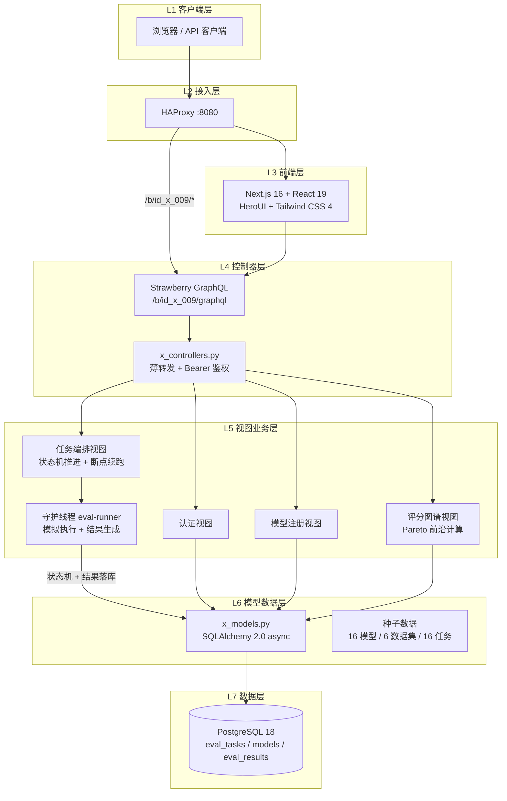
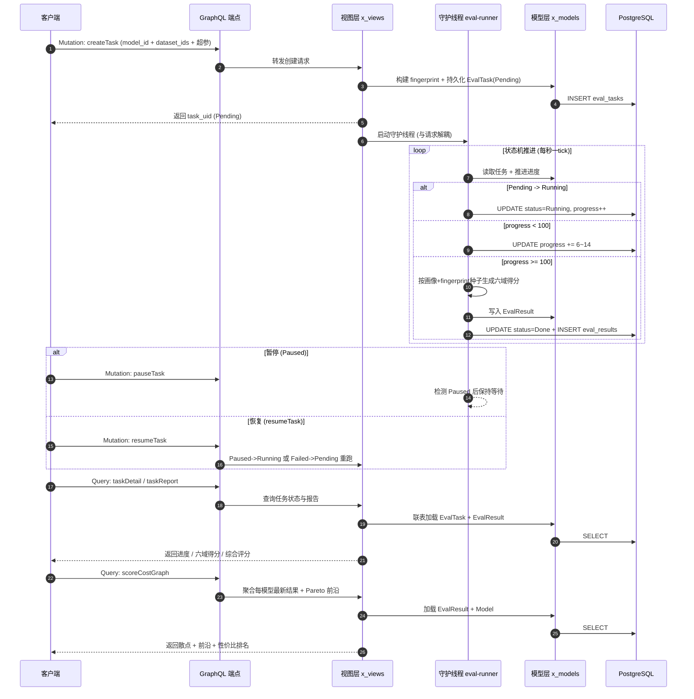

<div align="center">

# ID-009: AI 模型评测平台

**标准化 · 自动化 · 可复现 —— 面向组织内部的统一模型评估标尺**


</div>

---

## 1. 简介 (Introduction)

**Slogan**: 标准化 · 自动化 · 可复现 —— 面向组织内部的统一模型评估标尺。

**Description**: 随着大语言模型（Large Language Model, LLM）在组织内部快速落地，业务团队同时引入开源模型、自研模型与多个外部商用 API，模型数量快速增长、能力差异显著、版本迭代频繁。当前评测工作高度依赖人工脚本与零散的公开榜单，存在标准不统一、过程不可复现、结果难比较、成本不可控等突出问题，难以支撑组织级、多维度的模型选型与持续验收。

本平台以「六能力域加权聚合 × 推理成本」为核心评估标尺，构建一套四层解耦、配置即代码、全流程无人值守的评测基础设施 Demo：统一数据集、指标定义、评判协议与报告格式，覆盖模型选型、版本验收与上线前对齐，并以模型评分图谱（综合评分 × 推理成本散点 + 性价比前沿）为选型与成本决策提供统一视图。与同类方案相比，平台将「可复现指纹」「断点续跑」「性价比前沿」三项关键能力下沉为平台基座，开箱即有种子数据，评分图谱秒级可视。


<p align="center"><em>图 1-1 平台分层架构总览（实线分层 · 层间标准契约解耦）</em></p>

## 2. 核心特性 (Features)

- 标准化评测体系：统一评测数据集、六能力域指标定义、加权聚合协议与报告格式，结果横向可比、纵向可追。
- 全流程自动化：任务创建即入调度队列，守护线程推进状态机并落库，支持暂停（断点续跑）与失败重跑。
- 模型评分图谱：以「综合评分 × 推理成本」散点图谱叠加性价比前沿（Pareto Frontier），同模型多版本连点成线，支撑选型与成本决策。
- 可复现指纹：数据集快照、模型版本、推理引擎与超参四要素全程留痕，任意评分可一键回溯原始任务。
- GraphQL 统一端点：基于 Strawberry GraphQL 暴露 Query/Mutation，单一 `/b/id_x_009/graphql` 端点承载全部交互。

## 3. 项目亮点 (Highlights)

1. **性价比前沿选型** —— 服务端按成本升序扫描评分刷新包络计算 Pareto 前沿，并按「评分 / 成本」给出性价比排名，同成本最优评分模型一图可读。
2. **断点续跑与失败重跑** —— Running 可暂停（Paused 保持进度），Paused/Failed 均可由 `resumeTask` 重新接管；服务重启后遗留的 Pending 任务亦可被重新拉起。
3. **可复现指纹贯穿全程** —— `_build_fingerprint` 将数据集快照 + 模型版本 + 引擎版本 + 超参四要素序列化为任务指纹，结果生成以指纹为随机种子，同任务重算风格一致。
4. **守护线程与主循环解耦** —— 评测执行运行于独立守护线程，使用专属 asyncpg 引擎与独立事件循环，避免跨循环复用共享连接池导致 `attached to a different loop`，主请求循环不受长任务影响。
5. **多 Worker 进度一致** —— 任务状态与进度全程落库（非内存），Granian 多 worker 下任意进程轮询 `taskDetail` 均可见一致进度。
6. **六能力域加权聚合** —— 客观知识与推理（0.30）、语言与生成（0.20）、对齐与安全（0.15）、长上下文（0.15）、多模态（0.10）、业务专项（0.10）六域加权为综合评分，权重可配。

## 4. 技术栈 (Tech Stack)

<p align="center"><em>表 4-1 平台技术栈与功能作用</em></p>

| 分类 | 名称 | 版本 | 用途 |
| --- | --- | --- | --- |
| 前端框架 | Next.js | 16.2.3 | React 全栈应用框架 |
| 前端框架 | React | 19 | UI 组件渲染 |
| 前端组件 | HeroUI | - | 组件库 |
| 前端样式 | Tailwind CSS | 4 | 原子化样式 |
| 后端引擎 | Litestar | - | ASGI Web 框架 |
| 后端服务器 | Granian | - | 高性能 ASGI 服务器 |
| API 层 | Strawberry GraphQL | - | GraphQL Query/Mutation |
| ORM | SQLAlchemy | 2.0 async | 异步数据访问 |
| 数据库驱动 | asyncpg | - | 异步 PostgreSQL 驱动 |
| 数据库 | PostgreSQL | 18 | 任务/模型/指标元数据存储 |
| 负载均衡 | HAProxy | - | :8080 流量入口 |
| 部署 | Podman | - | 四容器同 Pod 编排 |

## 5. 整体架构图 (Overall Architecture Diagram)

平台采用四层分层架构（控制器薄转发 → 视图业务 → 模型数据 → 模式契约），自上而下依次为客户端、接入层、前端层、控制器层、视图业务层、模型数据层与数据层；评测执行由独立守护线程承担，与请求生命周期完全解耦。



<p align="center"><em>图 5-1 平台整体架构图（自上而下分层，守护线程承担评测执行）</em></p>

## 6. 请求流转图 (Request Flow Diagram)

以「创建并执行一次评测任务」为例，完整生命周期如下：客户端提交任务后立即返回，守护线程异步推进状态机，客户端轮询任务详情与报告，最终在评分图谱中可视化。



<p align="center"><em>图 6-1 评测任务请求流转图（含状态机推进、断点续跑与图谱聚合）</em></p>

任务状态机：Draft（草稿）→ Pending（待调度）→ Running（推理评判中）→ Done（完成）/ Failed（失败告警），Running 可切换至 Paused（暂停，支持断点续跑）；Paused 与 Failed 均可由 `resumeTask` 恢复。

## 7. 目录结构 (Directory Structure)

```text
id_x_009/
├── __init__.py
├── x_plugin.py                # 插件入口（懒加载 Base + 注入 session_maker）
├── requirements.txt           # Python 依赖
├── LICENSE                    # AGPL-3.0
├── README.md                  # 本文档
├── docs/
│   └── ops.md                 # 部署说明（拓扑 / 端口 / 种子数据 / 配置要点）
├── img/                       # 文档配图
│   ├── image_1.png            # 评测核心价值流
│   ├── image_2.png            # 平台分层架构总览
│   ├── image_3.jpeg           # 模型评分图谱样例
│   └── image_4.png            # 评分图谱 UI 界面样式样例
├── src/
│   ├── __init__.py
│   ├── controllers/
│   │   └── x_controllers.py   # 控制器层：GraphQL Query/Mutation 薄转发
│   ├── views/
│   │   └── x_views.py         # 视图层：认证 / 模型注册 / 任务编排 / 评分图谱
│   ├── models/
│   │   └── x_models.py        # 模型层：SQLAlchemy ORM（User/Model/Dataset/EvalTask/EvalResult）
│   └── schemas/
│       └── x_schemas.py       # 模式层：GraphQL 类型与 Input 契约
├── web/                       # 前端 (Next.js 16 + React 19)
│   ├── src/
│   │   ├── api/               # GraphQL / HTTP 封装
│   │   ├── app/f/             # 路由（login / register / forgot-password / home）
│   │   ├── components/        # 登录/注册/左面板/主题切换等组件
│   │   ├── views/Home.tsx     # 评测工作台与评分图谱主页
│   │   └── layout/            # 布局与 Providers
│   ├── public/
│   ├── Dockerfile
│   ├── next.config.ts
│   └── package.json
└── ops/                       # 运维编排
    ├── up.sh                  # 同 Pod 共享网络模式启动
    ├── down.sh                # 停止并清理
    ├── Dockerfile.service     # 后端镜像
    ├── haproxy.cfg            # HAProxy 配置
    ├── base_config.container.toml  # 容器内插件加载配置
    ├── .env.example           # 环境变量示例
    └── init/                  # 数据库初始化脚本
        ├── 01_init.sql        # 建表
        └── 02_seed.sql        # 种子数据（账号/模型/数据集/任务）
```

## 8. API 接口文档 (API Documentation)

### 端点

所有 API 通过统一的 GraphQL 端点暴露，需携带 Bearer Token 鉴权：

```text
POST /b/id_x_009/graphql
Authorization: Bearer <token>
Content-Type: application/json
```

### 操作一览

<p align="center"><em>表 8-1 GraphQL 操作汇总</em></p>

| 类型 | 操作 | 说明 | 关键入参 |
| --- | --- | --- | --- |
| Query | health | 健康检查 | 无 |
| Query | models | 模型注册中心列表（可按厂商/接入方式过滤） | vendor, access_type |
| Query | datasets | 评测数据集列表与版本快照 | 无 |
| Query | tasks | 评测任务列表（可按状态过滤） | status |
| Query | taskDetail | 任务详情与状态机当前状态 | task_uid |
| Query | taskReport | 评测报告（六域得分 + 综合评分 + 成本/时延/吞吐） | task_uid |
| Query | scoreCostGraph | 评分图谱（评分 × 成本散点 + Pareto 前沿 + 性价比排名） | filter |
| Mutation | login / register / logout / forgotPassword | 用户认证体系 | 邮箱/密码 |
| Mutation | registerModel | 注册模型（自研/开源/商用 API） | 模型元数据 |
| Mutation | createTask | 创建评测任务（数据集 + 模型 + 超参指纹） | model_id, dataset_ids, backend, 超参 |
| Mutation | pauseTask | 暂停任务（可断点续跑） | task_uid |
| Mutation | resumeTask | 恢复/重跑任务 | task_uid |

### 示例

创建评测任务：

```bash
curl -X POST http://localhost:8009/b/id_x_009/graphql \
  -H "Authorization: Bearer <TOKEN>" \
  -H "Content-Type: application/json" \
  -d '{
    "query": "mutation($input: CreateTaskInput!) { createTask(input: $input) { success message task { task_uid status progress } } }",
    "variables": {
      "input": {
        "name": "qwen3-max-regression",
        "modelId": 1,
        "datasetIds": [1, 2],
        "backend": "vllm",
        "temperature": 0.0,
        "maxTokens": 2048
      }
    }
  }'
```

响应示例：

```json
{
  "data": {
    "createTask": {
      "success": true,
      "message": "任务已创建并进入调度队列",
      "task": {
        "task_uid": "t-20260913-a1b2",
        "status": "Pending",
        "progress": 0
      }
    }
  }
}
```

查询评分图谱：

```bash
curl -X POST http://localhost:8009/b/id_x_009/graphql \
  -H "Authorization: Bearer <TOKEN>" \
  -H "Content-Type: application/json" \
  -d '{
    "query": "query { scoreCostGraph { points { name vendor compositeScore costPerTask onFrontier valueRank } frontier { x y } vendors } }"
  }'
```

## 9. 快速部署 (Quick Deploy)

### 9.1 环境准备 (Prerequisites)

- Docker 或 Podman ≥ 4.0（推荐 Podman，同 Pod 共享网络模式）
- 端口 8009 可用（宿主机映射端口）
- Git（克隆代码仓）

### 9.2 安装 (Installation)

```bash
# 进入运维目录
cd x_models/id_x_009/ops

# 生成环境变量配置（务必修改 POSTGRES_PASSWORD）
cp .env.example .env
```

### 9.3 运行 (Run)

```bash
# 一键启动四容器 Pod（haproxy + service + web + db）
# 镜像不存在时自动构建；已存在则幂等跳过
./up.sh

# 强制重建镜像并启动
./up.sh --build

# 停止并删除 Pod 与全部容器（数据卷保留）
./down.sh
```

部署完成后，通过 HAProxy 统一入口访问：

```text
http://localhost:8009
```

演示账号（种子数据，首次建库自动注入）：

```text
邮箱: demo@id-x-009.local
密码: demo123456
```

### 9.4 容器部署 (Podman Pod)

四容器同 Pod 共享 network namespace，容器间全部走 127.0.0.1：

```text
浏览器
  │  http://<host>:8009
  ▼
haproxy  (:8080 in pod)
  ├─ /b/id_x_009/*  →  service  (127.0.0.1:7000, Litestar + Granian ×3)
  └─ 其余           →  web      (127.0.0.1:2000, Next.js)
db                 (127.0.0.1:5432, PostgreSQL 18，数据卷 id_x_009_db)
```

关键配置（`.env`）：`POSTGRES_PASSWORD`（数据库密码）、`PROJECT_PATH`（容器内项目根路径，务必注入）、`POD_PORT`（宿主机端口，固定 8009）。

配置要点：`Dockerfile.service` 在主 `config/` COPY 之后用 `ops/base_config.container.toml` 覆盖镜像内 `config/base_config.toml`（`[EXTEND].MODELS` 仅指向 `id_x_009`），否则插件不加载 → GraphQL 404 → HAProxy 健康检查失败 → 503。切勿省略该 COPY。

## 10. 模型评分图谱 (Model Score Graph)

模型评分图谱是平台结果分析的核心可视化能力：以「综合评分 × 推理成本」为核心坐标，将全部已评测模型绘制为可交互二维散点图谱，并叠加性价比前沿（Pareto Frontier），为模型选型、版本验收与成本决策提供统一视图。

### 10.1 图谱价值

- 模型选型：同屏对比自研、开源与商用 API 模型，快速定位「高评分 · 低成本」甜点区模型。
- 性价比决策：以每任务推理成本（USD）为横轴、综合评分为纵轴，量化单位成本的能力收益。
- 版本演进追踪：同一模型多个版本连点成线，直观呈现迭代收益与成本变化。
- 基线沉淀：从图谱中一键将优选模型加入对比清单，生成对比报告并沉淀为生产基线。

### 10.2 图谱样例

下图样例数据源自 Artificial Analysis Intelligence Index v4.1，覆盖 128 个主流模型。横轴为每任务推理成本（美元，对数刻度），纵轴为智能指数综合评分；左上方「低成本 · 高评分」区域即为性价比甜点区。


<p align="center"><em>图 10-1 模型评分图谱样例（综合评分 × 推理成本，来源：Artificial Analysis）</em></p>

- 坐标读法：横轴成本按对数刻度展开，纵轴为加权综合评分，气泡越靠左上性价比越高。
- 前沿识别：虚线为性价比前沿，位于前沿上的模型代表当前成本档位的最优选择。
- 厂商对比：颜色区分厂商与系列，可快速识别各厂商在不同成本档位的布局密度。
- 异常发现：远离主体分布的离群点需重点复核，可能是评测异常或新晋高性价比模型。

### 10.3 UI 界面样式样例

平台 Web 控制台为模型评分图谱提供专属页面，整体采用「左筛选 · 中画布 · 右详情」三栏布局：


<p align="center"><em>图 10-2 模型评分图谱 UI 界面样式样例</em></p>

- 筛选面板：按厂商/系列、能力域指标、成本区间、评分区间、推理后端与时间范围组合过滤。
- 图谱画布：气泡即模型、颜色即厂商，支持悬浮查看指标详情、框选对比与甜点区高亮。
- 悬浮详情：悬停任意气泡即显示综合评分、成本、时延、吞吐与性价比排名。
- 模型详情卡：右侧展示选中模型的核心指标与能力域得分，支持一键加入对比清单。
- 对比清单：最多 4 个模型同屏对比，一键生成对比报告，支持 PDF / Excel 导出。

### 10.4 平台实现要点

- 数据来源：评分取自指标计算引擎的加权聚合结果（`EvalResult.composite_score`），成本取自 `cost_per_task`，时延与吞吐取自 `latency_p50` / `throughput`。
- 前沿计算：服务端按成本升序扫描、综合评分持续刷新的点构成 Pareto 前沿包络（`view_score_cost_graph`），并按「评分 / 成本」给出 `value_rank` 性价比排名。
- 血缘可追溯：每个气泡绑定 `task_uid`，点击可回溯原始评测任务与 `fingerprint`（数据集快照 + 模型版本 + 引擎 + 超参）。
- 每模型最新：图谱仅取每个模型的最新一条 `EvalResult`，避免同模型多次评测造成气泡重叠。
- 权限隔离：按项目空间过滤可见模型，商用 API 成本按租户隔离展示。
