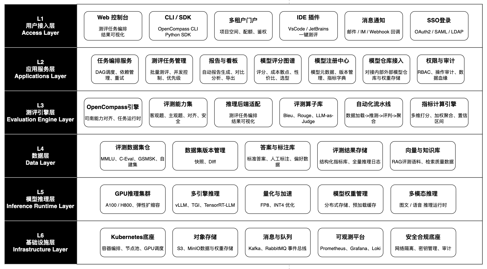
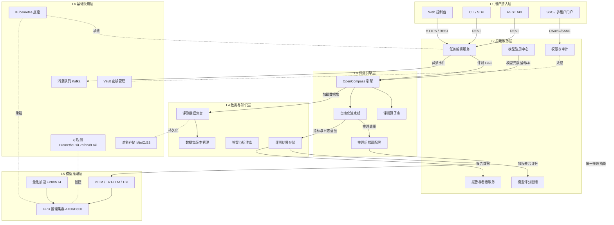
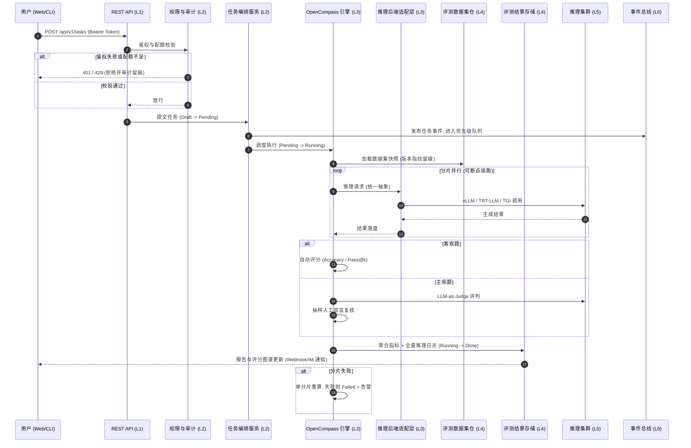
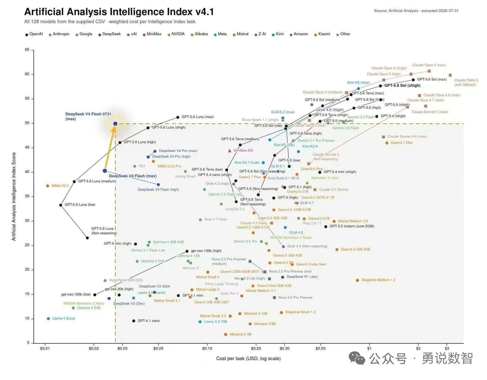
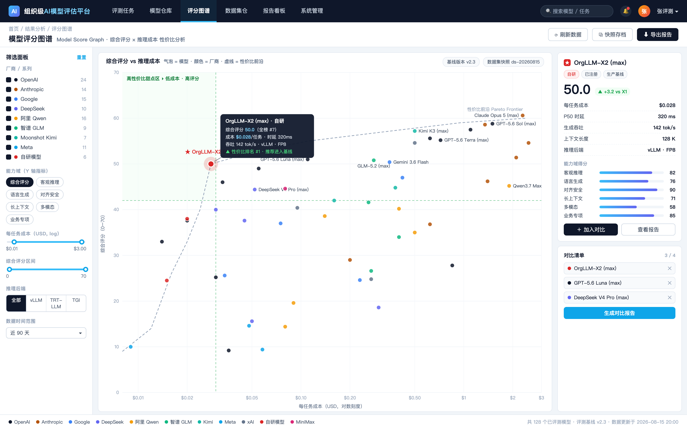

<div align="center">

# 企业级 AI 模型评估平台: 标准化大模型评测

**标准化 · 自动化 · 可复现 —— 面向组织内部的统一模型评估标尺**


</div>

---

## 1. 简介 (Introduction)

**Slogan**: 标准化 · 自动化 · 可复现 —— 面向组织内部的统一模型评估标尺。

**Description**: 随着大语言模型（Large Language Model, LLM）在组织内部快速落地，业务团队同时引入开源模型、自研模型与多个外部商用 API，模型数量快速增长、能力差异显著、版本迭代频繁。当前评测工作高度依赖人工脚本与零散的公开榜单，存在标准不统一、过程不可复现、结果难比较、成本不可控等突出问题，难以支撑组织级、多维度的模型选型与持续验收。

本平台以 OpenCompass 司南为对标基准，构建一套六层解耦、配置即代码、全流程无人值守的评测基础设施：统一数据集、指标定义、评判协议与报告格式，覆盖模型选型、版本验收、上线前对齐与安全评估，以及线上模型的持续回归与监控。与同类方案相比，平台在司南能力之上增强了组织数据集仓、多租户配额、安全合规评测包与持续回归四项组织级能力。



<p align="center"><em>图 1-1 平台分层架构总览（实线分层 · 层间标准契约解耦）</em></p>

## 2. 核心特性 (Features)

- 标准化评测体系：统一评测数据集、指标定义、评判协议与报告格式，结果横向可比、纵向可追。
- 全流程自动化：数据加载、模型推理、自动评判、结果聚合与报告生成端到端无人值守，支持断点续跑。
- 多维评测能力：覆盖客观知识与推理、语言与生成、对齐与安全、长上下文、多模态与业务专项六大能力域。
- 模型评分图谱：以「综合评分 × 推理成本」散点图谱叠加性价比前沿（Pareto Frontier），支撑选型与成本决策。
- 组织级治理：多租户隔离、RBAC 权限、GPU 配额调度、全链路审计与合规专项评测准入门禁。

## 3. 项目亮点 (Highlights)

1. **全程可复现** —— 数据集快照、模型版本、推理引擎与超参指纹四要素全程留痕，任何评分可一键回溯原始任务并重算。
2. **司南能力对齐 + 组织级增强** —— 复用 OpenCompass 任务模型与算子规范，叠加多租户配额、组织数据集仓与合规评测包，避免重复造轮子。
3. **性价比前沿选型** —— 将「高评分 · 低成本」甜点区量化可视，同系列版本连点成线，迭代收益与成本变化一图可读。
4. **断点续跑与分片重算** —— 推理结果落盘，失败分片单独重算，万级样本任务无需全量重跑，GPU 成本可控。
5. **云原生弹性推理** —— Kubernetes + Argo Workflows 编排，vLLM / TensorRT-LLM / TGI 多引擎择优，FP8/INT4 量化加速。
6. **持续回归闭环** —— 模型上线后按计划触发回归评测，对比历史基线自动告警，指标劣化即刻发现。

## 4. 技术栈 (Tech Stack)

<p align="center"><em>表 4-1 平台技术栈与功能作用</em></p>

| 分类 | 名称 | 版本 | 用途 |
| --- | --- | --- | --- |
| 编程语言 | Python | 3.10+ | 评测引擎、算子与后端服务实现 |
| 编程语言 | TypeScript | 5.x | Web 控制台前端 |
| 核心框架 | FastAPI | 0.110+ | REST API、任务编排与算子服务 |
| 核心框架 | React | 18.x | Web 控制台、报告与对比看板 |
| 评测引擎 | OpenCompass | 最新稳定版 | 司南能力对齐、任务运行时与配置规范 |
| 推理引擎 | vLLM / TensorRT-LLM / TGI | 最新稳定版 | 高吞吐 / 低延迟 / 多模型并行推理 |
| 任务调度 | Argo Workflows | 3.x | 评测 DAG 编排、分片并行与断点续跑 |
| 数据库/存储 | PostgreSQL | 13+ | 任务、模型、指标元数据与权限存储 |
| 数据库/存储 | Milvus | 2.x | RAG 评测语料与检索质量评估 |
| 数据库/存储 | MinIO / S3 | 最新稳定版 | 数据集、模型权重、推理日志与报告 |
| 数据库/存储 | Redis / Kafka | 7.x / 3.x | 任务状态缓存限流 / 事件总线 |
| 构建工具 | Kubernetes | 1.28+ | 容器编排、节点池与 GPU 调度 |
| 构建工具 | GitLab CI / ArgoCD / Terraform | 最新稳定版 | CI 构建、GitOps 部署与云资源声明式管理 |
| 可观测 | Prometheus / Grafana / Loki | 最新稳定版 | 指标采集、监控面板与全链路日志 |
| 可视化 | ECharts / AntV | 5.x | 评分图谱与评测结果多维图表 |
| 安全 | HashiCorp Vault | 1.x | API Key、模型凭证与密钥统一管理 |

## 5. 整体架构图 (Overall Architecture Diagram)

平台采用六层架构，自上而下分别为用户接入层、应用服务层、评测引擎层、数据与知识层、模型推理层和基础设施层，层间通过标准契约解耦，支持独立演进与替换。



<p align="center"><em>图 5-1 平台整体架构图（自上而下六层，箭头为关键调用链）</em></p>

## 6. 请求流转图 (Request Flow Diagram)

以「创建并执行一次评测任务」为例，完整生命周期如下：



<p align="center"><em>图 6-1 评测任务请求流转图（含鉴权、评判与异常分支）</em></p>

任务状态机：Draft（草稿）→ Pending（待调度）→ Running（推理评判中）→ Done（完成）/ Failed（失败告警），Running 可切换至 Paused（暂停，支持断点续跑）。

## 7. 目录结构 (Directory Structure)

```text
id_x_009/
├── README.md                 # 本文档（建设方案与平台说明）
├── LICENSE                   # AGPL-3.0 许可证
└── img/                      # 文档配图（架构图 / 价值流 / 图谱样例）
    ├── image_1.png           # 评测核心价值流
    ├── image_2.png           # 平台分层架构总览
    ├── image_3.jpeg          # 模型评分图谱样例
    └── image_4.png           # 评分图谱 UI 界面样式样例

# 平台代码仓（规划中的 monorepo 布局）
eval-platform/
├── api/                      # FastAPI 后端：任务/模型/数据集/报告服务
├── web/                      # React + TypeScript Web 控制台
├── engine/                   # OpenCompass 引擎封装与评测算子库
├── adapters/                 # vLLM / TRT-LLM / TGI 推理后端适配插件
├── datasets/                 # 公开基准与自建业务数据集（版本化快照）
├── deploy/
│   ├── helm/                 # Kubernetes Helm Chart
│   └── terraform/            # 云资源声明式管理
└── docs/                     # 算子开发指南与接入文档
```

## 8. API 接口文档 (API Documentation)

平台对外暴露 REST API（前缀 `/api/v1`），除豁免路径外均需 `Authorization: Bearer <TOKEN>`。以下为设计契约汇总：

<p align="center"><em>表 8-1 API 端点汇总</em></p>

| 方法 | 路径 | 说明 |
| --- | --- | --- |
| POST | /api/v1/tasks | 创建评测任务（数据集 + 模型 + 算子配置） |
| GET | /api/v1/tasks | 任务列表（按状态/项目空间过滤） |
| GET | /api/v1/tasks/{task_id} | 任务详情与状态机当前状态 |
| POST | /api/v1/tasks/{task_id}/pause | 暂停任务（可断点续跑） |
| POST | /api/v1/tasks/{task_id}/resume | 恢复/重跑失败分片 |
| GET | /api/v1/models | 模型注册中心列表（含版本） |
| POST | /api/v1/models | 注册模型（自研/开源/商用 API） |
| GET | /api/v1/datasets | 数据集列表与版本快照 |
| POST | /api/v1/datasets | 上传自建数据集（脱敏入库） |
| GET | /api/v1/tasks/{task_id}/report | 评测报告（JSON；`?format=pdf` 导出） |
| GET | /api/v1/graph/score-cost | 评分图谱数据（评分 × 成本散点 + 前沿） |
| GET | /api/v1/health | 健康检查（豁免鉴权） |

典型异常码：`400` 配置校验失败；`401` 未鉴权/Token 失效；`403` 越权访问项目空间；`404` 资源不存在；`429` 并发/GPU 配额超限。

创建评测任务示例：

```bash
curl -X POST "<BASE_URL>/api/v1/tasks" \
  -H "Authorization: Bearer <TOKEN>" \
  -H "Content-Type: application/json" \
  -d '{
    "name": "qwen2.5-72b-mmlu-regression",
    "model_version_id": 42,
    "dataset_snapshot_ids": [101, 103],
    "operators": ["accuracy", "llm_judge"],
    "backend": "vllm",
    "priority": "normal"
  }'
```

响应示例：

```json
{
  "task_id": "t-20260828-0007",
  "status": "Pending",
  "fingerprint": {
    "dataset": "ds@2026.08:snapshot-101",
    "model": "qwen2.5-72b@v3",
    "engine": "vllm@0.6",
    "hyper": {"temperature": 0.0, "max_tokens": 2048}
  }
}
```

## 9. 快速部署 (Quick Deploy)

### 9.1 环境准备 (Prerequisites)

- Kubernetes ≥ 1.28（含 GPU 节点池，NVIDIA Device Plugin 就绪）
- kubectl ≥ 1.28、Helm ≥ 3.12
- 对象存储（MinIO/S3）与 PostgreSQL ≥ 13 可用实例
- 评测引擎镜像仓库可访问（OpenCompass 运行时镜像）

### 9.2 安装 (Installation)

```bash
# 克隆平台代码仓
git clone <REPO_URL> eval-platform && cd eval-platform

# 配置命名空间与密钥（Vault 注入模型 API Key 等凭证）
kubectl create namespace eval-platform
```

### 9.3 运行 (Run)

```bash
# Helm 一键部署全部服务（API / 引擎 / 调度 / 前端）
helm upgrade --install eval-platform ./deploy/helm \
  -n eval-platform \
  --set global.storageClass=<STORAGE_CLASS> \
  --set postgresql.dsn=<PG_DSN> \
  --set minio.endpoint=<S3_ENDPOINT>

# 等待全部 Pod 就绪
kubectl -n eval-platform wait --for=condition=ready pod --all --timeout=600s
```

关键配置（`values.yaml` 覆盖项）：`global.storageClass`（持久卷）、`postgresql.dsn`（元数据库）、`minio.endpoint`（对象存储）、`gpu.pool`（推理节点池标签与配额）、`vault.addr`（密钥服务）。

### 9.4 容器部署 (Kubernetes)

```bash
# GitOps 方式（ArgoCD）持续部署
kubectl apply -f deploy/argocd/application.yaml

# 查看服务状态
kubectl -n eval-platform get pods,svc

# 端口转发本地访问 Web 控制台
kubectl -n eval-platform port-forward svc/eval-web 8080:80
# 浏览器访问 http://127.0.0.1:8080
```

### 9.5 实施路径（里程碑）

<p align="center"><em>表 9-1 分阶段实施路径</em></p>

| 阶段 | 周期 | 目标与交付物 |
| --- | --- | --- |
| 阶段一 · 底座搭建 | 第 1–2 月 | K8s 底座、对象存储、模型注册中心、OpenCompass 接入、单模型评测 MVP |
| 阶段二 · 引擎与数据 | 第 3–4 月 | 推理后端适配、公开数据集仓、任务编排状态机、自动评判与聚合 |
| 阶段三 · 平台化 | 第 5–6 月 | Web 控制台、多租户权限、自动报告与对比看板、安全合规评测包 |
| 阶段四 · 规模化 | 第 7–8 月 | GPU 弹性调度、持续回归、可观测告警、业务数据集持续运营 |

---

## 10. 模型评分图谱 (Model Score Graph)

模型评分图谱是平台结果分析的核心可视化能力：以「综合评分 × 推理成本」为核心坐标，将全部已评测模型绘制为可交互二维散点图谱，并叠加性价比前沿（Pareto Frontier），为模型选型、版本验收与成本决策提供统一视图。

### 10.1 图谱价值

- 模型选型：同屏对比自研、开源与商用 API 模型，快速定位「高评分 · 低成本」甜点区模型。
- 性价比决策：以每任务推理成本（USD，对数刻度）为横轴、综合评分为纵轴，量化单位成本的能力收益。
- 版本演进追踪：同一模型多个版本（low / medium / high / max）连点成线，直观呈现迭代收益与成本变化。
- 基线沉淀：从图谱中一键将优选模型加入对比清单，生成对比报告并沉淀为生产基线。

### 10.2 图谱样例

下图样例数据源自 Artificial Analysis Intelligence Index v4.1，覆盖 128 个主流模型。横轴为每任务推理成本（美元，对数刻度），纵轴为智能指数综合评分；左上方「低成本 · 高评分」区域即为性价比甜点区。



<p align="center"><em>图 10-1 模型评分图谱样例（综合评分 × 推理成本，来源：Artificial Analysis）</em></p>

- 坐标读法：横轴成本按对数刻度展开，纵轴为加权综合评分，气泡越靠左上性价比越高。
- 前沿识别：虚线为性价比前沿，位于前沿上的模型代表当前成本档位的最优选择。
- 厂商对比：颜色区分厂商与系列，可快速识别各厂商在不同成本档位的布局密度。
- 异常发现：远离主体分布的离群点需重点复核，可能是评测异常或新晋高性价比模型。

### 10.3 UI 界面样式样例

平台 Web 控制台为模型评分图谱提供专属页面，整体采用「左筛选 · 中画布 · 右详情」三栏布局：



<p align="center"><em>图 10-2 模型评分图谱 UI 界面样式样例</em></p>

- 筛选面板：按厂商/系列、能力域指标、成本区间、评分区间、推理后端与时间范围组合过滤。
- 图谱画布：气泡即模型、颜色即厂商，支持悬浮查看指标详情、框选对比与甜点区高亮。
- 悬浮详情：悬停任意气泡即显示综合评分、成本、时延、吞吐与性价比排名。
- 模型详情卡：右侧展示选中模型的核心指标与能力域得分，支持一键加入对比清单。
- 对比清单：最多 4 个模型同屏对比，一键生成对比报告，支持 PDF / Excel 导出。

### 10.4 平台实现要点

- 数据来源：评分取自指标计算引擎的加权聚合结果，成本由 token 单价与任务实测消耗计算，时延与吞吐取自全量推理日志。
- 维度可配：横纵轴支持评分、成本、时延、吞吐、上下文长度自由组合，默认配置如下表所示。

<p align="center"><em>表 10-1 模型评分图谱默认维度配置</em></p>

| 配置项 | 默认配置 | 可切换维度 |
| --- | --- | --- |
| X 轴（横轴） | 每任务推理成本（USD，对数刻度） | P50 时延 / 生成吞吐 / 上下文长度 |
| Y 轴（纵轴） | 综合评分（能力域加权聚合） | 单一能力域得分 / 安全专项分 |
| 气泡颜色 | 厂商 / 模型系列 | 推理后端 / 接入方式（自研·开源·商用API） |
| 气泡大小 | 固定 | 日均调用量 / 评测频次 |
| 连 线 | 同系列版本演进连线 | 性价比前沿（Pareto Frontier）开关 |

- 血缘可追溯：每个气泡绑定数据集快照、模型版本、推理引擎与超参指纹，点击可回溯原始评测任务。
- 前端渲染：基于 ECharts / AntV 实现大规模气泡的流畅渲染与缩放，图谱快照可存档复现。
- 权限隔离：按项目空间过滤可见模型，商用 API 成本按租户隔离展示。
