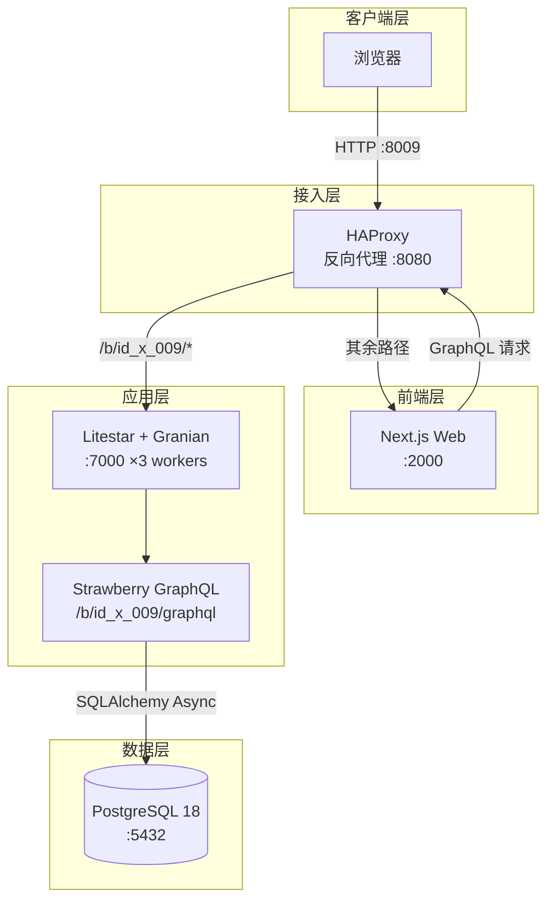
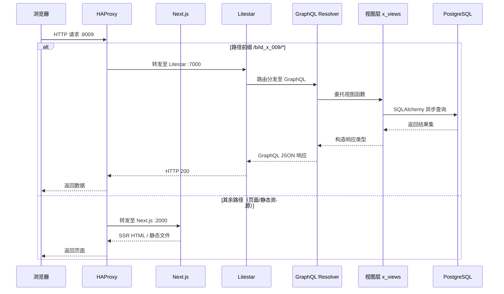

<div align="center">

# ID-009: AI 模型评测平台

**一站式大模型评测、评分图谱与性价比分析平台**


</div>

---

## 1. 简介 (Introduction)

**Slogan**: 一站式大模型评测、评分图谱与性价比分析平台。

**Description**: ID-009 是一个面向大语言模型（LLM）的全栈评测平台 Demo，覆盖模型注册、数据集管理、评测任务调度、六能力域评分、成本分析及评分-成本 Pareto 图谱可视化。平台采用 GraphQL API 驱动，前后端分离架构，支持多厂商模型（OpenAI / Anthropic / Google / DeepSeek / Alibaba / Meta / Moonshot / Zhipu / MiniMax / Mistral）的统一接入与横向对比，帮助团队快速完成模型选型与性价比决策。

与同类项目相比，ID-009 的核心差异在于：将评测执行、结果聚合与可视化分析整合为闭环，内置 Pareto 前沿计算引擎，开箱即用的种子数据让首次部署即可呈现完整的评分图谱。

## 2. 核心特性 (Features)

- **模型注册中心** — 支持自研 / 开源 / 商用 API 三类接入方式，统一登记厂商、系列、版本、推理后端与参数量等元数据
- **评测任务调度** — 完整的任务状态机（Draft → Pending → Running → Paused → Done / Failed），支持断点续跑与进度持久化
- **六能力域评分** — 客观知识与推理、语言与生成、对齐与安全、长上下文、多模态、业务专项，加权聚合为综合评分
- **评分-成本图谱** — 交互式气泡图可视化，X 轴为每任务推理成本（USD），Y 轴为综合评分，支持多维度筛选与 Pareto 前沿标注
- **用户认证体系** — 注册 / 登录 / 令牌认证 / 密码重置全流程，与前端 Next.js 深度集成

## 3. 项目亮点 (Highlights)

1. **Pareto 前沿内置计算** — 服务端直接返回按成本升序、评分刷新包络的 Pareto 前沿点列与性价比排名，前端零计算即可渲染专业级图谱
2. **任务状态机与断点续跑** — 守护线程每秒推进进度并落库，服务重启后遗留任务可通过 `resumeTask` 重新接管，工程可靠性经过验证
3. **六能力域加权聚合** — 预定义六大能力域及权重（推理 30% / 语言 20% / 对齐 15% / 长上下文 15% / 多模态 10% / 业务 10%），支持按域独立分析与综合评分
4. **四容器 Pod 一键部署** — HAProxy + Next.js + Litestar + PostgreSQL 同 Pod 共享网络命名空间， `./up.sh` 幂等启动，30 秒内完成全栈部署
5. **开箱即用种子数据** — 首次建库自动注入 16 个主流模型、6 个评测数据集、16 个已完成评测任务及结果，评分图谱开箱即有数据
6. **黑白学术风格 UI** — 前端遵循学术刊物图表规范（Nature / Science 风格），厂商调色板高对比低饱和，Pareto 前沿以深邃暗琥珀色突出边界语义

## 4. 技术栈 (Tech Stack)

表 4-1 技术栈一览

| 分类 | 名称 | 版本 | 用途 |
|:---|:---|:---|:---|
| 编程语言 | Python | 3.10 | 后端服务 |
| 编程语言 | TypeScript | 5.x | 前端开发 |
| 后端框架 | Litestar | latest | ASGI Web 框架 |
| ASGI 服务器 | Granian | latest | 高性能 Rust ASGI 服务器 |
| GraphQL | Strawberry GraphQL | latest | GraphQL Schema 与 Resolver |
| ORM | SQLAlchemy + Advanced Alchemy | 2.x | 异步数据库操作 |
| 数据库 | PostgreSQL | 18 | 持久化存储 |
| 前端框架 | Next.js | 16.2 | React SSR/SSG 框架 |
| UI 组件 | HeroUI | 3.x | React 组件库 |
| 动画 | Framer Motion | 12.x | 页面过渡与交互动画 |
| 样式 | Tailwind CSS | 4.x | 原子化 CSS |
| 反向代理 | HAProxy | 3.0 | 四容器 Pod 流量入口 |
| 容器引擎 | Podman | latest | 容器编排与部署 |

## 5. 整体架构图 (Overall Architecture Diagram)



## 6. 请求流转图 (Request Flow Diagram)



## 7. 目录结构 (Directory Structure)

```
id_x_009/
├── docs/                    # 项目文档
│   └── ops.md               # 部署说明文档
├── img/                     # 图片资源
├── ops/                     # 容器部署配置
│   ├── init/                # 数据库初始化脚本
│   ├── Dockerfile.service   # 后端服务镜像
│   ├── base_config.container.toml  # 容器专用配置
│   ├── haproxy.cfg          # HAProxy 反向代理配置
│   ├── up.sh                # 一键启动脚本
│   └── down.sh              # 停止清理脚本
├── src/                     # 后端源码
│   ├── controllers/         # GraphQL 控制器层（thin resolvers）
│   │   └── x_controllers.py
│   ├── models/              # SQLAlchemy ORM 模型
│   │   └── x_models.py
│   ├── schemas/             # Strawberry GraphQL Schema
│   │   └── x_schemas.py
│   └── views/               # 业务视图层（全部业务逻辑）
│       └── x_views.py
├── web/                     # 前端 Next.js 应用
│   ├── public/              # 静态资源
│   ├── src/
│   │   ├── api/             # GraphQL API 客户端
│   │   ├── app/             # Next.js App Router 页面
│   │   ├── assets/          # 图片等资源
│   │   ├── components/      # React 组件
│   │   ├── context/         # React Context
│   │   ├── hooks/           # 自定义 Hooks
│   │   ├── layout/          # 布局组件
│   │   ├── utils/           # 工具函数
│   │   └── views/           # 页面视图组件
│   │       └── Home.tsx     # 主页面（评分图谱/任务/模型/数据集）
│   ├── Dockerfile           # 前端镜像
│   ├── next.config.ts       # Next.js 配置
│   └── package.json         # 前端依赖
├── x_plugin.py              # i-Core 插件入口
├── requirements.txt         # Python 依赖
└── README.md                # 本文件
```

## 8. API 接口文档 (API Documentation)

所有接口通过 GraphQL 端点暴露，路径为 `/b/id_x_009/graphql`。

表 8-1 GraphQL 操作一览

| 类型 | 操作名 | 说明 |
|:---|:---|:---|
| Query | `health` | 健康检查 |
| Query | `models(vendor, accessType)` | 模型注册中心列表 |
| Query | `datasets` | 评测数据集列表 |
| Query | `tasks(status)` | 评测任务列表 |
| Query | `taskDetail(taskUid)` | 评测任务详情 |
| Query | `taskReport(taskUid)` | 评测报告（六能力域 + 综合评分） |
| Query | `scoreCostGraph(filter)` | 评分-成本图谱数据 |
| Mutation | `login(input)` | 用户登录 |
| Mutation | `register(input)` | 用户注册 |
| Mutation | `forgotPassword(input)` | 忘记密码 |
| Mutation | `logout` | 用户登出 |
| Mutation | `registerModel(input)` | 注册模型 |
| Mutation | `createTask(input)` | 创建评测任务 |
| Mutation | `pauseTask(taskUid)` | 暂停任务 |
| Mutation | `resumeTask(taskUid)` | 恢复/重跑任务 |

### 8.1 查询示例

**获取评分-成本图谱数据**

```graphql
query {
  scoreCostGraph(filter: { minScore: 80, maxCost: 5.0 }) {
    points {
      modelId
      name
      vendor
      compositeScore
      costPerTask
      onFrontier
      valueRank
    }
    frontier {
      x
      y
    }
    vendors
  }
}
```

**创建评测任务**

```graphql
mutation {
  createTask(input: {
    name: "GPT-5.2 全量评测"
    modelId: 1
    datasetIds: [1, 2, 3]
    backend: "vllm"
    temperature: 0.0
    maxTokens: 2048
  }) {
    success
    message
    task {
      taskUid
      status
      progress
    }
  }
}
```

### 8.2 curl 调用示例

```bash
curl -X POST http://<BASE_URL>/b/id_x_009/graphql \
  -H "Content-Type: application/json" \
  -H "Authorization: Bearer <TOKEN>" \
  -d '{"query": "query { health { status service } }"}'
```

## 9. 快速部署 (Quick Deploy)

### 9.1 环境准备 (Prerequisites)

- Podman 4.x+
- 至少 4 GB 可用内存
- 宿主机端口 8009 未被占用

### 9.2 安装 (Installation)

```bash
# 克隆仓库（假设已纳入 i-Core  monorepo）
cd x_models/id_x_009/ops

# 生成环境变量文件
cp .env.example .env
# 编辑 .env，修改 POSTGRES_PASSWORD
```

### 9.3 运行 (Run)

```bash
# 一键启动（镜像不存在时自动构建；已存在则幂等跳过）
./up.sh

# 强制重建镜像并启动
./up.sh --build

# 停止并删除 Pod 与全部容器（数据卷保留）
./down.sh
```

启动后访问 `http://<host>:8009`，默认演示账号：`demo@id-x-009.local` / `demo123456`。

### 9.4 容器部署 (Podman Pod)

本项目采用四容器同 Pod 部署，共享 network namespace，容器间通过 `127.0.0.1` 通信：

```bash
# 手动构建镜像（在 i-Core 仓库根目录执行）
podman build -t id_x_009-service -f x_models/id_x_009/ops/Dockerfile.service .
podman build -t id_x_009-web -f x_models/id_x_009/web/Dockerfile \
  --build-arg NEXT_PUBLIC_BASE_URL="" \
  --build-arg NEXT_PUBLIC_SUB_VERSION="/b/id_x_009/graphql" \
  x_models/id_x_009/web

# 创建 Pod 并映射端口
podman pod create --name id_x_009 -p 8009:8080

# 启动各容器（详细命令见 ops/up.sh）
podman run -d --pod id_x_009 --name id_x_009-db ...
podman run -d --pod id_x_009 --name id_x_009-service ...
podman run -d --pod id_x_009 --name id_x_009-web ...
podman run -d --pod id_x_009 --name id_x_009-haproxy ...
```

## 10. 模型评分图谱 (Model Score Graph)

### 10.1 图谱价值

评分图谱是 ID-009 的核心差异化功能：将每个模型的综合评分（Y 轴）与每任务推理成本（X 轴，USD）投射到二维平面，形成直观的气泡图。气泡大小与参数量正相关，颜色按厂商区分，Pareto 前沿以深色虚线标注，帮助决策者一眼识别"高性价比区间"——即同成本下评分最高、或同评分下成本最低的模型集合。

### 10.2 图谱样例


*图 10-1 评分图谱样例：16 个主流模型的评分-成本分布与 Pareto 前沿*

### 10.3 UI 界面样式样例


*图 10-2 平台主界面：左侧筛选面板、中间评分图谱画布、右侧模型详情*

### 10.4 平台实现要点

- **服务端 Pareto 计算**：`scoreCostGraph` 返回按成本升序排列的 Pareto 前沿点列，前端直接渲染无需额外计算
- **多维度筛选**：支持按厂商、接入方式、推理后端、最低评分、最高成本组合筛选，筛选条件变更后自动重新查询
- **响应式三栏布局**：桌面端左筛选 / 中画布 / 右详情三栏等高；窄屏自动堆叠，筛选面板可折叠
- **学术风格配色**：厂商调色板严格交替冷暖色，明度统一在 50-55%，饱和度 60-70%，符合 Nature / Science 图表规范
