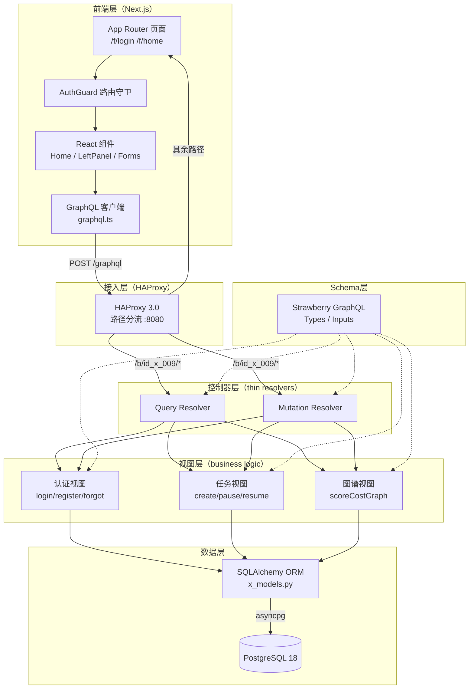
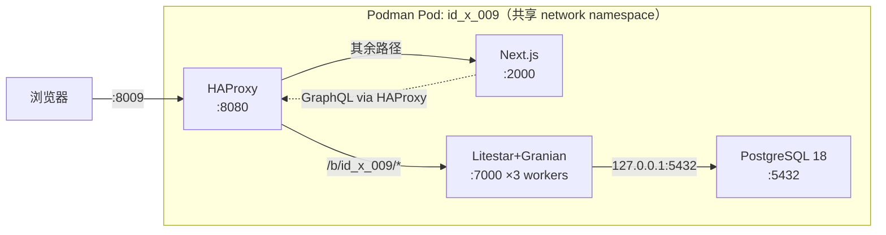
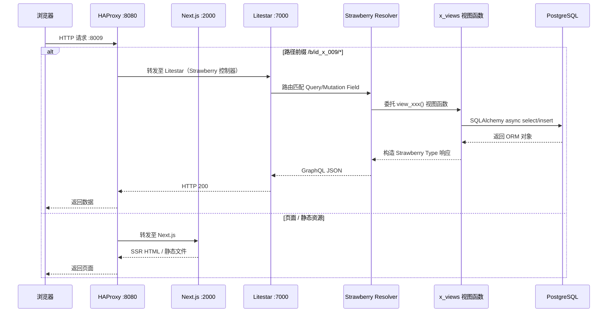
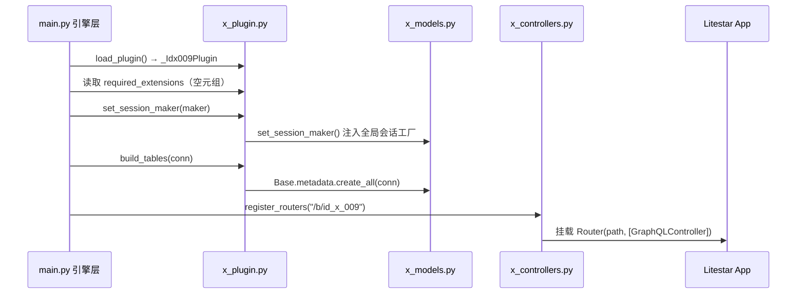
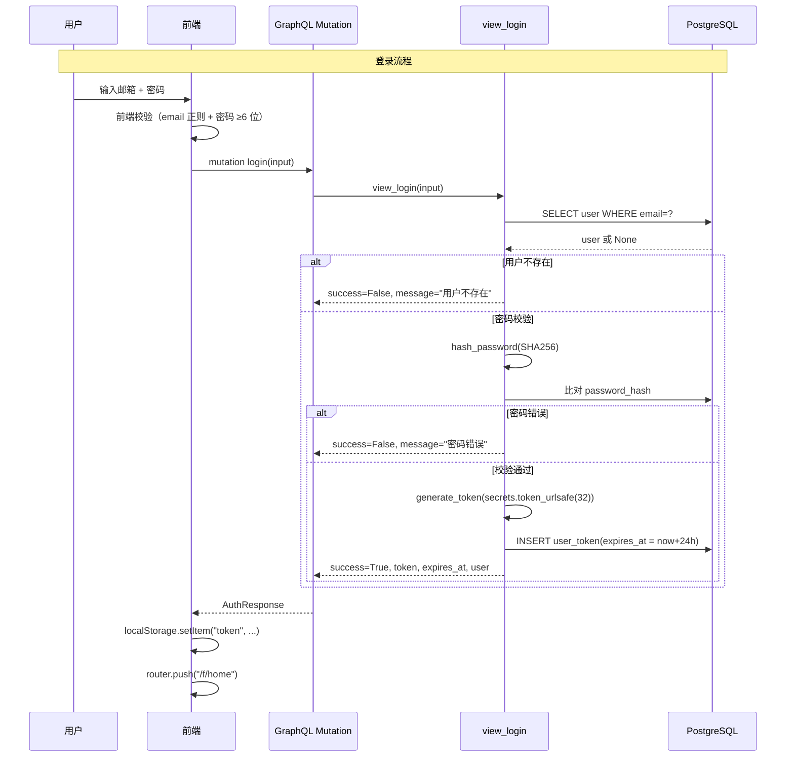
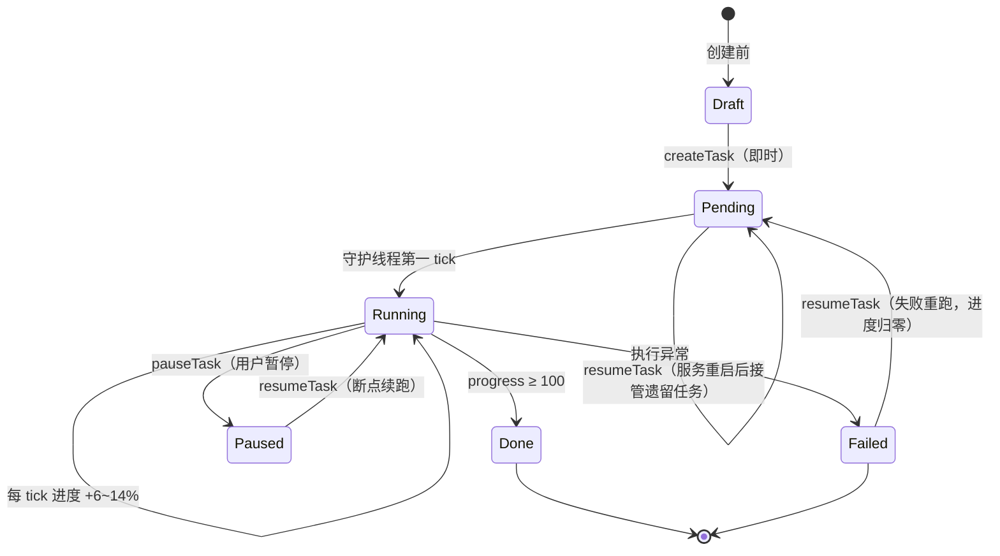
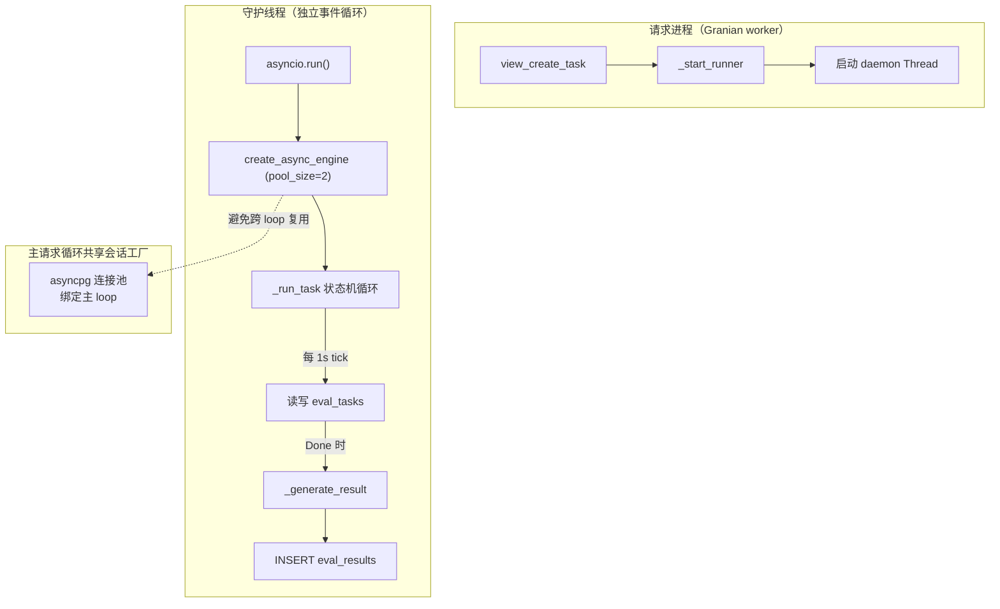
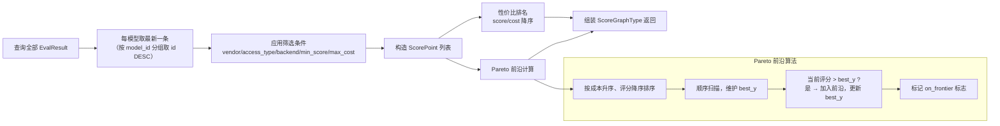

# id_x_009 技术侧拆解

**项目名称**：ID-009 AI 模型评测平台
**文档类型**：技术架构拆解报告
**拆解日期**：2026 年 10 月 16 日
**定位**：一站式大模型评测、评分图谱与性价比分析平台 Demo

---

## 目录

1. [项目概述](#1-项目概述)
2. [整体架构](#2-整体架构)
3. [技术栈](#3-技术栈)
4. [核心数据模型](#4-核心数据模型)
5. [实现流程](#5-实现流程)
6. [前端实现](#6-前端实现)
7. [部署与运维](#7-部署与运维)
8. [安全合规分析](#8-安全合规分析)
9. [工程亮点与局限](#9-工程亮点与局限)
10. [总结](#10-总结)

---

## 1. 项目概述

### 1.1 项目定位

ID-009 是一个面向大语言模型（LLM）的全栈评测平台 Demo，覆盖**模型注册 → 数据集管理 → 评测任务调度 → 六能力域评分 → 成本分析 → 评分-成本 Pareto 图谱可视化**的完整闭环。平台通过 GraphQL API 驱动前后端分离架构，支持 OpenAI / Anthropic / Google / DeepSeek / Alibaba / Meta / Moonshot / Zhipu / MiniMax / Mistral 等 10 家厂商模型的统一接入与横向对比。

### 1.2 核心差异化

| 维度 | ID-009 方案 | 同类项目常见做法 |
|:---|:---|:---|
| 评测执行 | 守护线程模拟执行 + 状态机落库 | 需对接真实推理后端 |
| 评分聚合 | 六能力域加权（推理 30% / 语言 20% / 对齐 15% / 长上下文 15% / 多模态 10% / 业务 10%） | 单一总分 |
| 性价比分析 | 服务端 Pareto 前沿计算 + 性价比排名 | 前端自行计算或缺失 |
| 可视化 | 学术风格气泡图（Nature / Science 配色规范） | 通用图表 |
| 部署 | 四容器同 Pod 一键启动，30 秒就绪 | 多机部署 |
| 种子数据 | 首次建库自动注入 34 模型 + 6 数据集 + 34 评测结果 | 空库启动 |

### 1.3 在 i-Core 体系中的角色

ID-009 作为 i-Core monorepo 的一个**业务插件**存在，通过 `x_plugin.py` 实现 `PluginInterface` 契约，由引擎层（`main.py` / Litestar 实例）统一加载、注入数据库会话工厂并挂载路由。这种设计使各业务模块（id_x_013、id_x_009 等）可独立开发、按需装载，共享引擎层基础设施。

---

## 2. 整体架构

### 2.1 分层架构

项目采用**严格分层**设计，每层职责单一、向下依赖：



**分层职责约定**（严格遵循）：

| 层 | 文件 | 职责 | 禁止事项 |
|:---|:---|:---|:---|
| 控制器层 | `x_controllers.py` | GraphQL 端点签名定义、参数透传 | 不含业务逻辑、不操作数据库 |
| 视图层 | `x_views.py` | 全部业务逻辑、数据库读写、算法计算 | 不定义 GraphQL schema |
| Schema 层 | `x_schemas.py` | GraphQL Type / Input 声明 | 不含逻辑 |
| 模型层 | `x_models.py` | ORM 模型、表结构、关系映射 | 不含业务逻辑 |

### 2.2 四容器 Pod 拓扑



**Pod 设计要点**：
- 四容器同 Pod 部署，共享 network namespace，容器间全部走 `127.0.0.1`，零网络开销
- 仅 HAProxy 的 `:8080` 发布到宿主机 `:8009`，其余端口不暴露
- 每个容器配置独立的健康检查（`pg_isready` / `curl` / HTTP 状态码白名单）

### 2.3 请求流转



### 2.4 插件装配机制

ID-009 以插件身份被引擎层加载，装配流程如下：



- `x_plugin.py` 采用**懒加载**策略：`base` 属性在首次访问时才 import `x_models`，避免主程序加载插件时立即触发可能未就绪的 ORM 注册链
- `required_extensions` 返回空元组——009 模型表仅用基础类型，不依赖 pgcrypto / pgvector 等 PostgreSQL 扩展

---

## 3. 技术栈

### 3.1 技术栈总览

| 分类 | 技术 | 版本 | 选型理由 |
|:---|:---|:---|:---|
| 后端语言 | Python | 3.10 | async/await 原生支持，生态成熟 |
| Web 框架 | Litestar | latest | 现代 ASGI 框架，内置依赖注入、插件体系 |
| ASGI 服务器 | Granian | latest | Rust 编写的高性能 ASGI 服务器，多 worker |
| GraphQL | Strawberry GraphQL | latest | Python 原生类型注解 → GraphQL Schema，代码优先 |
| ORM | SQLAlchemy 2.x | 2.x | 异步 ORM，Mapped 声明式模型 |
| ORM 扩展 | Advanced Alchemy | latest | Litestar 配套，提供异步会话管理 |
| 数据库驱动 | asyncpg | latest | 异步 PostgreSQL 驱动，高性能 |
| 同步驱动 | psycopg2 | latest | openpyxl/pandas 等同步工具链备用 |
| 数据处理 | pandas + openpyxl | latest | 数据集导入导出备用 |
| 数据库 | PostgreSQL | 18 | 关系型持久化，JSON/Text/索引支持完善 |
| 前端框架 | Next.js | 16.2.3 | App Router SSR/SSG，React 19 |
| UI 组件库 | HeroUI | 3.x | 现代 React 组件库，无样式预设 |
| 动画 | Framer Motion | 12.x | 声明式动画，页面过渡 |
| 样式 | Tailwind CSS | 4.x | 原子化 CSS，Design Token 驱动 |
| 反向代理 | HAProxy | 3.0 | 路径分流 + 健康检查 + 长连接超时 |
| 容器引擎 | Podman | 4.x+ | 无守护进程容器，Pod 原生支持 |
| 前端运行时 | Node.js | 24 | Alpine 镜像，Next.js 生产运行 |
| 后端镜像 | Python | 3.10-slim | 精简基础镜像 |

### 3.2 依赖清单

**后端**（`requirements.txt`）：

```
toml / tomli          # 配置解析
python-dotenv         # .env 加载
granian               # ASGI 服务器
litestar[all]         # Web 框架全家桶
advanced_alchemy      # 异步 ORM 扩展
asyncpg               # 异步 PG 驱动
aiohttp               # 异步 HTTP 客户端
pydantic              # 数据校验
strawberry-graphql    # GraphQL
psycopg2              # 同步 PG 驱动
openpyxl / pandas     # 数据处理
```

**前端**（`package.json` 核心依赖）：

```
next@16.2.3           / react@19.2.4 / react-dom@19.2.4
@heroui/react@^3.2.2  / framer-motion@^12.42.2
tailwindcss@^4        / typescript@^5
react-aria 系列        # 无障碍交互原语
```

---

## 4. 核心数据模型

### 4.1 ER 关系图

```mermaid
erDiagram
    User ||--o{ UserToken : "1:N 认证令牌"
    User ||--o{ PasswordResetToken : "1:N 重置令牌"
    Model ||--o{ EvalResult : "1:N 评测结果"
    EvalTask ||--|| EvalResult : "1:1 唯一结果"
    EvalTask }o--|| Model : "N:1 评测模型"
    EvalResult }o--|| Model : "N:1 所属模型"

    User {
        int id PK
        string email UK
        string phone
        string password_hash
        bool is_active
        datetime created_at
        datetime updated_at
    }

    UserToken {
        int id PK
        int user_id FK
        string token UK
        datetime expires_at
        datetime created_at
    }

    PasswordResetToken {
        int id PK
        int user_id FK
        string token UK
        datetime expires_at
        bool used
        datetime created_at
    }

    Model {
        int id PK
        string name
        string vendor
        string series
        string version
        string access_type
        string backend
        float params_b
        int context_length
        datetime created_at
    }

    Dataset {
        int id PK
        string name
        string version
        string snapshot
        string domain
        int sample_count
        text description
        datetime created_at
    }

    EvalTask {
        int id PK
        string task_uid UK
        string name
        int model_id FK
        text dataset_ids
        string backend
        string status
        int progress
        text fingerprint
        text error
        datetime created_at
        datetime updated_at
    }

    EvalResult {
        int id PK
        int task_id UK_FK
        int model_id FK
        float score_reasoning
        float score_language
        float score_alignment
        float score_longctx
        float score_multimodal
        float score_business
        float composite_score
        float cost_per_task
        float latency_p50
        float throughput
        datetime created_at
    }
```

### 4.2 七张表职责

| 表名 | 职责 | 关键设计 |
|:---|:---|:---|
| `users` | 用户主表 | email 唯一索引、phone 可选索引、is_active 激活标志 |
| `user_tokens` | 登录令牌 | token 唯一索引、expires_at 过期校验、`is_valid()` 方法 |
| `password_reset_tokens` | 密码重置令牌 | used 一次性标志、1 小时过期、旧令牌自动作废 |
| `models` | 模型注册中心 | vendor/series 双索引、access_type（selfhost/api/opensource）、backend（vllm/trtllm/tgi/api） |
| `datasets` | 评测数据集仓 | version + snapshot 版本化快照、domain 能力域索引 |
| `eval_tasks` | 评测任务 | task_uid 外部标识、status 状态机、progress 进度、fingerprint 可复现指纹 |
| `eval_results` | 评测结果 | task_id 唯一约束（1:1）、六能力域得分 + 综合评分 + 成本/时延/吞吐 |

### 4.3 索引策略

| 表 | 索引字段 | 类型 | 用途 |
|:---|:---|:---|:---|
| users | email | UNIQUE INDEX | 登录查询 + 唯一约束 |
| users | phone | INDEX | 手机号查询 |
| user_tokens | token | UNIQUE INDEX | 令牌验证 |
| password_reset_tokens | token | UNIQUE INDEX | 重置令牌验证 |
| models | vendor, series | INDEX | 厂商/系列筛选 |
| datasets | domain | INDEX | 能力域筛选 |
| eval_tasks | task_uid | UNIQUE INDEX | 外部标识查询 |
| eval_tasks | status | INDEX | 状态机过滤 |
| eval_results | model_id | INDEX | 模型结果查询 |
| eval_results | composite_score | INDEX | 评分排序 |

### 4.4 数据库触发器

`01_init.sql` 定义了 `update_updated_at_column()` 函数与触发器，在 `users` 和 `eval_tasks` 表 UPDATE 时自动刷新 `updated_at`，与 ORM 层的 `onupdate=_utcnow` 形成双重保障。

---

## 5. 实现流程

### 5.1 认证流程



**认证三表同构设计**：`users` / `user_tokens` / `password_reset_tokens` 三表与 id_x_013 插件同构，便于跨插件复用认证逻辑。

**令牌生命周期**：
- 生成：`secrets.token_urlsafe(32)` —— 43 字符 URL 安全随机串
- 有效期：24 小时（`timedelta(hours=24)`）
- 校验：`is_valid()` 比对 `expires_at > now(utc)`
- 登出：前端清除 `localStorage`，后端 `view_logout` 直接返回成功（无服务端令牌失效）

### 5.2 评测任务状态机



**状态机实现要点**（`_run_task` 函数）：

| 状态 | 守护线程行为 | 进度变化 |
|:---|:---|:---|
| `Draft` | — | 初始态，createTask 时直接跳过 |
| `Pending` | 检测到 → 置 `Running`，progress=1 | — |
| `Running` | 每 tick（1s）进度 += random(6,14) | 持续推进 |
| `Paused` | `continue` 等待 resume | 保持不变（断点保持） |
| `Done` | progress ≥ 100 → 生成 EvalResult → `return` | 锁定 100 |
| `Failed` | 异常捕获 → 写入 error 字段 → `return` | 保持 |

### 5.3 守护线程与模拟执行

评测执行为**模拟执行**模式——创建任务后由独立守护线程推进状态机，按模型画像生成六能力域得分与成本。核心实现位于 `_start_runner` / `_run_task_with_own_engine` / `_run_task`：



**关键工程决策——独立引擎**：
> 守护线程内使用「专属引擎 + 独立事件循环」。共享会话工厂的 asyncpg 连接池绑定主请求循环，跨循环复用会报 `attached to a different loop`，因此执行线程必须自建连接（用完即 `dispose()`）。

**模拟执行的数据生成**（`_generate_result`）：

1. 按 `model.name` 查找 `_MODEL_PROFILES` 画像（基础能力分 + 每任务成本 USD）
2. 未命中则按 `model.vendor` 查找 `_VENDOR_DEFAULT_PROFILE`
3. 以 `f"{task_uid}:{fingerprint}"` 为种子构造 `random.Random`（可复现风格）
4. 六能力域得分 = 基础分 + `uniform(-4, 4)` 抖动，clamp 到 [20, 99]
5. 综合评分 = 六域加权求和（权重见 5.4）
6. 成本 = 基础成本 × `uniform(0.9, 1.1)`，下限 0.01
7. 时延 = `uniform(200, 1200)` ms，吞吐 = `uniform(30, 180)` tokens/s

### 5.4 六能力域加权评分

```python
DOMAIN_SPECS = [
    ("reasoning",  "客观知识与推理", 0.30),
    ("language",   "语言与生成",     0.20),
    ("alignment",  "对齐与安全",     0.15),
    ("longctx",    "长上下文",       0.15),
    ("multimodal", "多模态",         0.10),
    ("business",   "业务专项",       0.10),
]
# 权重总和 = 1.00
```

| 能力域 | 权重 | 对应数据集 | 评测重点 |
|:---|:---|:---|:---|
| 客观知识与推理 | 30% | mmlu-pro | 研究生级多任务理解与推理 |
| 语言与生成 | 20% | arena-hard-gen | 开放式生成质量（LLM-as-Judge） |
| 对齐与安全 | 15% | safety-bench | 安全合规准入门禁 |
| 长上下文 | 15% | longctx-ruler | 128K 窗口检索与追踪 |
| 多模态 | 10% | mmmu-lite | 图文混合理解与推理 |
| 业务专项 | 10% | biz-kb-qa | 业务知识库问答 |

综合评分计算：`composite = Σ(score_domain × weight)`，结果保留两位小数。

### 5.5 Pareto 前沿计算引擎

`view_score_cost_graph` 是平台核心差异化能力，服务端直接返回 Pareto 前沿点列，前端零计算即可渲染：



**算法详解**（`x_views.py` 第 948-962 行）：

```python
# 按成本升序排列（同成本时评分高者优先）
ordered = sorted(points, key=lambda p: (p.cost_per_task, -p.composite_score))
frontier = []
best_y = float("-inf")
for p in ordered:
    if p.composite_score > best_y:
        best_y = p.composite_score          # 刷新评分包络
        frontier.append(FrontierPoint(x=p.cost_per_task, y=p.composite_score))
        frontier_model_ids.add(p.model_id)
```

**语义**：从成本最低的点开始向右扫描，每遇到一个综合评分超过此前所有点的模型，即纳入前沿。前沿上的点满足「同成本下评分最高」的帕累托最优条件。

**性价比排名**：`value_rank = sorted(points, key=score/cost, reverse=True)`，按评分/成本比降序编号。

### 5.6 任务可复现指纹

`_build_fingerprint` 将评测的四要素固化为 JSON 指纹，确保结果可溯源、可复现：

```json
{
  "dataset": ["mmlu-pro@2026.08:snapshot-101", ...],
  "model": "gpt-5.2@5.2",
  "engine": "api@0.6",
  "hyper": {"temperature": 0.0, "max_tokens": 2048}
}
```

| 要素 | 来源 | 复现作用 |
|:---|:---|:---|
| dataset | 各 Dataset.snapshot | 数据集版本快照锁定 |
| model | `{name}@{version}` | 模型版本锁定 |
| engine | `{backend}@0.6` | 推理引擎与版本锁定 |
| hyper | temperature + max_tokens | 超参数锁定 |

指纹同时作为 `random.Random` 种子，使模拟执行结果在相同指纹下可复现。

### 5.7 断点续跑与故障恢复

| 场景 | 触发条件 | 处理逻辑 |
|:---|:---|:---|
| 用户暂停 | `pauseTask`，状态 Running → Paused | 守护线程 `continue` 等待，进度保持 |
| 用户恢复 | `resumeTask`，状态 Paused → Running | 守护线程下一 tick 恢复推进 |
| 执行失败 | 守护线程异常 | 状态置 Failed，写入 error，线程退出 |
| 失败重跑 | `resumeTask`，状态 Failed → Pending | progress 归零，error 清空，启动新守护线程 |
| 服务重启遗留 | 重启后 Pending 任务（旧线程已消亡） | `resumeTask` 检测 Pending → 启动新守护线程接管 |

**可靠性保障**：状态全程落库（`eval_tasks.status` / `progress`），Granian 多 worker 下任意进程都能读到一致的进度。

---

## 6. 前端实现

### 6.1 路由结构

```
web/src/app/
├── layout.tsx              → 重新导出 @/layout/RootLayout
├── page.tsx                → 重新导出 @/views/Home（根路由）
└── f/
    ├── login/page.tsx      → <LoginPage />
    ├── register/page.tsx   → <RegisterPage />
    ├── forgot-password/    → <ForgotPasswordPage />
    └── home/page.tsx       → <AuthGuard><Home /></AuthGuard>
```

**路由守卫模式**：`/f/home` 页面包裹 `AuthGuard` 组件，在 `useEffect` 中检查 `localStorage.token`，无 token 则重定向至 `/f/login`。`next.config.ts` 配置根路径 `/` 重定向到 `/f/login`。

### 6.2 前端分层

| 层 | 目录 | 职责 |
|:---|:---|:---|
| 页面 | `app/f/*/page.tsx` | Next.js App Router 路由入口 |
| 视图 | `views/Home.tsx` | 主页面（评分图谱/任务/模型/数据集四 Tab） |
| 组件 | `components/` | LoginPage / RegisterPage / LeftPanel / AuthGuard / ThemeToggle / ui/ |
| API 客户端 | `api/graphql.ts` / `api/http.ts` | GraphQL 请求封装、类型定义 |
| Context | `context/ThemeContext.tsx` | 主题（明/暗）全局状态 |
| Layout | `layout/RootLayout.tsx` / `Providers.tsx` | HTML 骨架、ThemeProvider 注入 |
| 工具 | `utils/config.ts` / `utils/tokens.ts` | API 地址配置、Design Token |
| 资源 | `assets/styles/globals.css` | 全局样式 + Tailwind |

### 6.3 GraphQL 客户端

`api/graphql.ts` 封装了 `GraphQLClient` 类：

- **请求头自动注入**：`getDefaultHeaders()` 从 `localStorage.token` 读取并添加 `Authorization: Bearer <token>`
- **SSR 安全**：`typeof window !== "undefined"` 守卫，避免服务端渲染时访问 localStorage
- **错误处理**：HTTP 状态码 + GraphQL `errors` 字段双重校验
- **类型完备**：所有请求/响应均有 TypeScript interface 定义，与后端 Schema 一一对应

两大 API 对象：
- `userGraphqlApi`：register / login / forgotPassword / logout
- `evalGraphqlApi`：listModels / listDatasets / listTasks / getTaskDetail / getTaskReport / getScoreCostGraph / registerModel / createTask / pauseTask / resumeTask

### 6.4 Design Token 体系

`utils/tokens.ts` 定义统一的 `DesignTokens` 接口，明暗两套配色通过 `getTokens(isDark)` 切换：

| Token | 亮色 | 暗色 | 用途 |
|:---|:---|:---|:---|
| bg | #f5f5f7 | #000000 | 页面背景 |
| card | #ffffff | #1c1c1e | 卡片背景 |
| fg | #1d1d1f | #ffffff | 主文字 |
| accent | #000000 | #ffffff | 强调色（按钮、链接） |
| error | #dc2626 | #dc2626 | 错误色 |
| divider | rgba(0,0,0,0.06) | rgba(255,255,255,0.08) | 分割线 |

文档约定：**所有组件必须从 `tokens.ts` 导入，防止值漂移**。

### 6.5 评分图谱可视化

`Home.tsx` 的 `graph` Tab 渲染评分-成本气泡图，核心设计：

| 元素 | 编码维度 | 实现 |
|:---|:---|:---|
| X 轴 | 每任务推理成本（USD） | 对数刻度适配 $0.003 ~ $24.2 跨度 |
| Y 轴 | 综合评分（0-100） | 线性刻度 |
| 气泡颜色 | 厂商 | `VENDOR_PALETTE`（10 色冷暖交替） |
| 气泡大小 | 参数量（B） | 半径映射 |
| Pareto 前沿 | 暗琥珀虚线 `#1A1208` | 服务端返回 frontier 点列 |
| 性价比排名 | `valueRank` 字段 | 标注于气泡旁 |

**厂商调色板规范**（学术风格）：
- 色相均衡分布，覆盖蓝/红/绿/橙/紫/粉/青/黄/灰紫/棕
- 序列内严格交替冷暖，保证相邻序号高感知距离
- 明度统一 50-55%、饱和度 60-70%，符合 Nature / Science 图表规范
- Pareto 前沿用暗琥珀色（明度极低），与厂商点形成明度反差

---

## 7. 部署与运维

### 7.1 部署拓扑

```
宿主机 :8009
    └── Pod: id_x_009（共享 network namespace）
            ├── id_x_009-haproxy   :8080  (HAProxy 3.0)
            ├── id_x_009-web        :2000  (Next.js 16, Node 24-alpine)
            ├── id_x_009-service    :7000  (Litestar + Granian ×3 workers)
            └── id_x_009-db         :5432  (PostgreSQL 18)
```

### 7.2 一键部署脚本（up.sh）

`up.sh` 实现幂等启动，执行顺序：

1. **加载 .env**（不存在则从 `.env.example` 生成并退出提示修改）
2. **构建镜像**（`--build` 强制重建，或镜像不存在时自动构建）
   - service 镜像：构建上下文为 i-Core 根，COPY 引擎层 + id_x_009 + _contracts
   - web 镜像：构建上下文为 `web/`，注入 `NEXT_PUBLIC_*` 构建参数
3. **创建 Pod**：`podman pod create --name id_x_009 -p 8009:8080`
4. **创建数据卷**：`id_x_009_db` 持久化 PostgreSQL 数据
5. **创建日志目录**：解析 i-Core 根的绝对路径，`mkdir -p logs/`（macOS Podman bind mount 兼容）
6. **启动容器**（顺序：db → service → web → haproxy）
7. **健康检查等待**：db 健康检查最长 60s 轮询
8. **输出状态**：`podman pod ls` + `podman ps`

**幂等性**：每个容器启动前检查 `podman container exists`，已存在则跳过。

### 7.3 健康检查配置

| 容器 | 健康检查命令 | 间隔 | 超时 | 重试 | 启动宽限 |
|:---|:---|:---|:---|:---|:---|
| db | `pg_isready -U postgres -d id_x_009` | 10s | 5s | 10 | 20s |
| service | `curl -s -o /dev/null http://127.0.0.1:7000/b/id_x_009/graphql` | 15s | 5s | 10 | 30s |
| web | HAProxy `httpchk GET /`（期望 200/307/308） | 10s | — | 3 fall / 2 rise | — |
| haproxy | — | — | — | — | — |

### 7.4 镜像构建策略

**后端镜像（Dockerfile.service）**：

| 步骤 | 内容 | 缓存优化 |
|:---|:---|:---|
| 基础镜像 | `python:3.10-slim` | — |
| 系统依赖 | build-essential / libpq-dev / curl | apt 层 |
| Python 依赖 | `pip install -r requirements.txt` | requirements 变化才重装 |
| 源码复制 | main.py / src / utils / config / x_models/_contracts / x_models/id_x_009 | 按需复制，不带其他插件 |
| 配置覆盖 | `base_config.container.toml` → `config/base_config.toml` | 关键：MODELS 指向 id_x_009 |
| 启动命令 | `python main.py` | Granian 作为 ASGI 服务器 |

**前端镜像（Dockerfile）**：多阶段构建
- 构建阶段：`node:24-alpine`，`npm install`（npmmirror 镜像源），`npm run build`
- 运行阶段：`node:24-alpine`，仅复制 `.next` / `public` / `node_modules` / 配置文件

### 7.5 容器配置覆盖机制

`Dockerfile.service` 在 COPY 主 `config/` 之后，用 `ops/base_config.container.toml` 覆盖镜像内 `config/base_config.toml`。核心差异：

```toml
# 共享配置（宿主机开发用）
[EXTEND]
MODELS = [
    ["id_x_013", "/id_x_013"],
    ["id_x_009", "/id_x_009"],
    # ... 其他插件
]

# 容器专用配置
[EXTEND]
MODELS = [
    ["id_x_009", "/id_x_009"],   # 仅加载 id_x_009
]
```

**如果不覆盖**：镜像内只含 id_x_009 文件，但 MODELS 指向其他插件 → 插件不加载 → `/b/id_x_009/graphql` 路由 404 → HAProxy 健康检查失败 → 503。

### 7.6 种子数据

`ops/init/02_seed.sql` 由 PostgreSQL 容器首次启动时自动执行（`docker-entrypoint-initdb.d`）：

| 数据 | 数量 | 内容 |
|:---|:---|:---|
| 演示账号 | 1 | demo@id-x-009.local / demo123456（SHA256 哈希） |
| 模型 | 34 | 覆盖 10 家厂商、3 种接入方式、参数量 2B ~ 671B |
| 数据集 | 6 | 六能力域各一，版本快照 2026.08 |
| 评测任务 | 34 | 全部 Done 状态，与模型一一对应 |
| 评测结果 | 34 | 六域得分 + 综合评分（63.0 ~ 97.8）+ 成本（$0.012 ~ $24.2） |

种子结果与后端 `_MODEL_PROFILES` 画像同源，保证后续增量任务风格一致。

---

## 8. 安全合规分析

### 8.1 认证安全

| 项目 | 当前实现 | 评估 | 风险等级 |
|:---|:---|:---|:---|
| 密码哈希算法 | `hashlib.sha256`（单次） | ⚠️ SHA256 非密码哈希算法，无加盐、无迭代，易被彩虹表攻击 | **高** |
| 密码长度策略 | 前端 ≥6 位 + 后端 ≥6 位 | ⚠️ 6 位过短，建议 ≥8 位并含复杂度要求 | 中 |
| 令牌生成 | `secrets.token_urlsafe(32)` | ✅ 密码学安全随机数，43 字符 | 低 |
| 令牌有效期 | 24 小时 | ✅ 合理 | 低 |
| 令牌存储 | 前端 `localStorage` | ⚠️ localStorage 易受 XSS 攻击窃取，建议 HttpOnly Cookie | 中 |
| 令牌失效 | 登出仅清前端，无服务端失效 | ⚠️ 登出后令牌在有效期内仍可用 | 中 |
| 登录失败限速 | 无 | ⚠️ 可被暴力破解 | 中 |
| 用户激活 | 注册即激活（`is_active=True`） | ⚠️ Demo 简化，生产应邮件验证 | 低 |

**改进建议**：
1. 密码哈希改用 `bcrypt`（`passlib`）或 `argon2-cffi`，自动加盐 + 可调成本因子
2. 令牌改用 JWT（签发时含过期时间），服务端可维护黑名单实现真正登出
3. 引入登录失败计数 + IP 限速（如 5 次/分钟）
4. 令牌存储改用 HttpOnly + Secure + SameSite Cookie

### 8.2 接口鉴权

| 项目 | 当前实现 | 评估 |
|:---|:---|:---|
| GraphQL 端点鉴权 | `verify_token()` 函数存在但 **Resolver 未调用** | ⚠️ 所有 Query/Mutation 均无鉴权，任何人可访问模型/任务/图谱数据 |
| AuthGuard 前端守卫 | 仅检查 `localStorage.token` 存在性 | ⚠️ 前端守卫可绕过（直接请求 GraphQL 端点） |
| 敏感操作鉴权 | registerModel / createTask / pauseTask / resumeTask 均无鉴权 | ⚠️ 任意未认证用户可创建/修改任务 |

**改进建议**：在 Strawberry Resolver 中集成 `Info` 对象，从请求头提取 token 并调用 `verify_token()`，对 Mutation 全部强制鉴权，对敏感 Query（如任务详情）按需鉴权。

### 8.3 传输安全

| 项目 | 当前实现 | 评估 | 风险等级 |
|:---|:---|:---|:---|
| TLS/HTTPS | HAProxy 仅监听 HTTP :8080 | ⚠️ 明文传输，密码/令牌可被中间人窃听 | **高** |
| CORS | `CORS_ORIGINS = "*"` | ⚠️ 允许任意来源跨域，生产应白名单限制 | 中 |
| CSRF 防护 | 无 | ⚠️ GraphQL POST 无 CSRF Token | 低（令牌在 Header） |

**改进建议**：
1. HAProxy 增加 TLS 终止（或前置 Nginx/Traefik 做 TLS），监听 443
2. CORS 改为显式域名白名单
3. 生产环境强制 HTTPS（HSTS Header）

### 8.4 配置安全

| 项目 | 当前实现 | 评估 | 风险等级 |
|:---|:---|:---|:---|
| LLM API Key | `base_config.container.toml` 硬编码 `sk-...` | ⚠️ 密钥入库，泄露风险 | **高** |
| SECRET_KEY | 硬编码 `bW9vbmxhYg==`（base64 "moonlab"） | ⚠️ 可预测，签名可伪造 | **高** |
| 数据库密码 | `.env.example` 默认 `change-me`，`up.sh` 回退默认 `P@sspostgres!` | ⚠️ 默认密码若未修改即上线 | 中 |
| 演示账号 | 种子数据固定 `demo@id-x-009.local / demo123456` | ⚠️ 公开仓库可见，生产必须删除 | 中 |

**改进建议**：
1. 所有密钥改从环境变量 / 密钥管理服务（Vault / AWS Secrets Manager）注入
2. `.env.example` 仅放占位符，`up.sh` 检测到默认密码时拒绝启动
3. 生产镜像不包含演示账号种子数据
4. 项目应接入 secret 扫描（如 `git-secrets` / `trufflehog`），当前硬编码 API Key 建议立即轮换

### 8.5 数据安全

| 项目 | 当前实现 | 评估 |
|:---|:---|:---|
| SQL 注入 | SQLAlchemy 参数化查询（`select().where()`） | ✅ ORM 层天然防注入 |
| 数据库连接 | asyncpg 异步连接池，执行线程独立引擎 | ✅ 连接隔离合理 |
| 敏感数据日志 | `logger.warning(f"令牌不存在: {token[:8]}...")` | ✅ 令牌仅打印前 8 字符，脱敏处理 |
| 错误信息泄漏 | `message=f"登录失败: {str(e)}"` | ⚠️ 异常堆栈直接返回客户端，可能泄漏内部信息 |
| 数据删除 | `down.sh` 保留数据卷 | ✅ 数据不随容器删除丢失 |
| 数据备份 | 无 | ⚠️ 需补充 pg_dump 定时备份策略 |

**改进建议**：
1. 异常信息对客户端返回通用提示，详细堆栈仅入日志
2. 补充数据库备份脚本（pg_dump + 卷快照）

### 8.6 安全风险清单汇总

| 编号 | 风险 | 等级 | 位置 | 建议优先级 |
|:---|:---|:---|:---|:---|
| S-01 | SHA256 单次哈希（无盐无迭代） | 高 | `x_views.py:hash_password` | P0 |
| S-02 | GraphQL 端点无鉴权 | 高 | `x_controllers.py` 全部 Resolver | P0 |
| S-03 | API Key 硬编码入库 | 高 | `base_config.container.toml:38` | P0 |
| S-04 | SECRET_KEY 可预测 | 高 | `base_config.container.toml:16` | P0 |
| S-05 | 无 TLS/HTTPS | 高 | `haproxy.cfg` | P1 |
| S-06 | CORS `*` 通配 | 中 | `base_config.container.toml:51` | P1 |
| S-07 | 令牌存储 localStorage | 中 | 前端 `graphql.ts` / `LoginPage.tsx` | P1 |
| S-08 | 登出无服务端失效 | 中 | `x_views.py:view_logout` | P1 |
| S-09 | 无登录限速 | 中 | `x_views.py:view_login` | P2 |
| S-10 | 异常信息泄漏 | 低 | 各 view 函数 catch 块 | P2 |
| S-11 | 演示账号固定 | 中 | `02_seed.sql` | P2（生产移除） |
| S-12 | 默认数据库密码 | 中 | `up.sh:61` / `.env.example` | P2 |

> **说明**：以上风险基于 Demo 定位评估。作为演示项目，部分简化（如 SHA256、无 TLS）可接受；但若用于生产或公网暴露，P0/P1 项必须修复。

---

## 9. 工程亮点与局限

### 9.1 工程亮点

1. **严格的分层架构**
   - 控制器层零业务逻辑（thin resolvers），全部委托视图层
   - Schema / Model / View / Controller 四层职责清晰，可独立演进
   - 这种分层使 GraphQL 签名变更不影响业务逻辑，业务逻辑变更不影响数据契约

2. **Pareto 前沿服务端计算**
   - 前端零计算即可渲染专业级性价比图谱
   - 算法正确性经服务端单点保证，避免前端多端实现不一致
   - 同时返回 `on_frontier` 标志与 `value_rank` 排名，前端渲染信息完备

3. **任务状态机与断点续跑**
   - 六状态机（Draft/Pending/Running/Paused/Done/Failed）覆盖完整生命周期
   - 状态全程落库，Granian 多 worker 下任意进程可见一致进度
   - 服务重启后遗留 Pending 任务可通过 `resumeTask` 重新接管

4. **独立引擎的跨循环解决方案**
   - 守护线程自建 asyncpg 引擎，避免跨事件循环复用共享连接池
   - 用完即 `dispose()`，连接生命周期与线程绑定
   - 主请求循环的连接池不受执行线程影响

5. **可复现指纹设计**
   - 数据集快照 + 模型版本 + 引擎版本 + 超参四要素固化
   - 指纹同时作为随机种子，模拟执行结果可复现
   - 为真实评测的可复现性预留了工程框架

6. **四容器 Pod 一键部署**
   - `up.sh` 幂等启动，30 秒全栈就绪
   - 同 Pod 共享 network namespace，容器间零网络开销
   - 容器健康检查全覆盖，自动等待依赖就绪

7. **开箱即用种子数据**
   - 首次建库自动注入完整数据链（34 模型 + 6 数据集 + 34 评测结果）
   - 评分图谱开箱即有数据，降低体验门槛
   - 种子画像与运行时画像同源，增量任务风格一致

8. **Design Token 驱动的前端体系**
   - 明暗配色通过 `getTokens(isDark)` 统一切换
   - 所有组件从 `tokens.ts` 导入，防止值漂移
   - 厂商调色板遵循学术刊物配色规范

### 9.2 已知局限

| 编号 | 局限 | 影响 | 缓解方向 |
|:---|:---|:---|:---|
| L-01 | 评测为模拟执行，非真实推理 | 评分数据为画像+抖动生成，非真实模型输出 | 对接 vLLM / TGI / API 真实推理后端 |
| L-02 | 六能力域得分无真实评测逻辑 | 仅为 `base_score ± uniform(4)` | 集成 MMLU-Pro / SafetyBench 等评测框架 |
| L-03 | 无任务队列与并发控制 | 守护线程直接 start，高并发下线程爆炸 | 引入 Celery / RQ 任务队列 |
| L-04 | 无分页机制 | 模型/任务列表全量返回 | GraphQL 分页（ Relay Connection） |
| L-05 | dataset_ids 以 JSON 字符串存储 | 无法直接 JOIN 查询 | 改用关联表 `task_datasets` |
| L-06 | 无数据集上传/管理功能 | 数据集仅通过种子 SQL 注入 | 增加 CSV/JSON 上传 + 校验 |
| L-07 | 无图表导出功能 | 评分图谱仅屏幕展示 | 增加 SVG/PNG 导出 |
| L-08 | 前端无 i18n | 中英文混合 | 接入 next-intl |
| L-09 | 无自动化测试 | 无单元/集成/E2E 测试 | 补充 pytest + Playwright |
| L-10 | README 提及 hooks 目录但实际不存在 | 文档与代码不同步 | 补充或移除文档引用 |

### 9.3 技术债务

| 债务 | 位置 | 说明 |
|:---|:---|:---|
| Dockerfile.web 注释写 `id_x_013` | `web/Dockerfile:2-7` | 复制自 013 未改注释 |
| `view_logout` 无实际登出逻辑 | `x_views.py:435-440` | 直接返回成功，未删除令牌 |
| `validateToken` 前端仅检查 localStorage.user | `AuthGuard.tsx:33-48` | 未调用后端验证接口 |
| `console.log("Login result:", result)` | `LoginPage.tsx:57` | 调试日志未清理 |
| `http.ts` 客户端未被使用 | `api/http.ts` | 项目全走 GraphQL，HTTP 客户端为冗余 |

---

## 10. 总结

ID-009 是一个**架构清晰、分层严格、开箱即用**的 AI 模型评测平台 Demo。其核心价值在于：

**架构层面**：四层分层（Controller / View / Schema / Model）职责清晰，GraphQL 代码优先（Strawberry）使 schema 与代码同步，插件化设计（`PluginInterface`）使其可作为 i-Core 生态的可插拔模块。

**业务层面**：将评测执行、六能力域加权评分、Pareto 前沿计算、评分-成本可视化整合为闭环，服务端计算前卫沿使前端零计算即可呈现专业级图谱。任务状态机与断点续跑机制为真实评测场景预留了工程框架。

**工程层面**：四容器 Pod 一键部署、守护线程独立引擎解决跨循环问题、可复现指纹设计、种子数据开箱即用，体现了对 Demo 快速验证与生产演进的双重考量。

**安全层面**：作为 Demo，认证体系完整（注册/登录/令牌/密码重置全流程）但存在多项需加固项——SHA256 单次哈希、GraphQL 无鉴权、硬编码密钥、无 TLS 为 P0 风险，生产化前必须修复。SQL 注入防护（ORM 参数化）、令牌脱敏日志等基础安全实践已到位。

**演进路径**：从 Demo 到生产，核心需补齐三块——①真实推理后端对接（替换模拟执行）、②安全加固（见 8.6 风险清单 P0/P1）、③任务队列与并发控制（支撑规模化评测）。指纹与状态机的设计为此预留了扩展空间。
