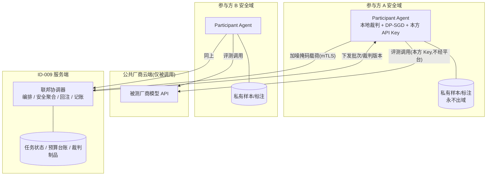

# 面向隐私保护的分布式 AI 模型增量训练模块设计报告

**项目名称**:ID-009 AI 模型评测平台
**文档类型**:模块设计报告
**模块代号**:PPDIT(Privacy-Preserving Distributed Incremental Training)
**所属组织**:SME
**设计日期**:2026 年 11 月 1 日
**适用前提**:被测目标模型均为公共厂商 API 模型,不涉及本地模型与自训练模型

**修订记录**

| 版本 | 变更说明 |
|:---|:---|
| v1.0 | 初稿:训练对象为被测基座的 LoRA 增量版本,回注模型注册中心 |
| v2.0 | 适配"仅公共厂商模型"前提:训练对象重定位为平台测算资产;嵌入点改为"数据集 + 评分结果"双落点 |
| v2.1 | 精简文字表述 |
| v2.2 | 聚焦方案与可行性:移除目录、数据模型字段定义、API 定义、目录结构与部署细节 |

---

## 1. 设计背景与动机

### 1.1 现状:业务专项分数是平台可信度的最薄弱环节

ID-009 已形成"模型注册 → 评测调度 → 六能力域评分 → Pareto 图谱"的测算闭环,但"业务专项"域(权重 10%)的分数质量存在结构性缺陷:

1. **评测集缺位**——真实业务样本散落在各业务方私域,受《个人信息保护法》《数据安全法》及 GDPR 约束不能出域;
2. **裁判缺位**——业务域答案需领域知识评判,通用 LLM-as-Judge 打分不准;
3. **当前为画像模拟**——业务域分数由画像 + 抖动生成,不反映真实表现。

对以"分数"为核心商品的平台,测不准的分数会直接误导选型决策。

### 1.2 关键前提:被测对象不可训练

被测模型均为公共厂商 API 模型,"用私有数据改进被测模型"的全部路径被封死:

| 路径 | 为何不可行 |
|:---|:---|
| 本地权重微调 | 闭源:无权重、无梯度,不存在训练入口 |
| 厂商托管微调 | 须上传私有语料,隐私与合规不可接受 |
| 引入本地 / 自训练模型 | 与平台定位冲突 |

### 1.3 结论:训练测算的尺子,而非被测的模型

排除法可得:平台体系内唯一可增量训练的对象是**平台自身的测算资产**。PPDIT 作用于三类资产:

| 训练对象 | 形态 | 增量含义 |
|:---|:---|:---|
| **联邦评测** | 分布式评测协议(样本不出域) | 私域样本持续新增,分数逐轮逼近真实 |
| **业务域裁判模型** | 轻量开源模型(2~7B)+ LoRA,平台工具资产 | 各方私有标注联邦训练,评分准确性持续进化 |
| **评分预测器** | 轻量预测模型 | 私有使用反馈联邦训练,为厂商新模型提供冷启动预估分 |

原始数据、标注、API Key 全部留在参与方域内;上行仅有差分隐私加噪、安全聚合掩码后的分数统计量与裁判增量。被测模型只被调用、不被改动。

---

## 2. 模块定位与业务闭环

### 2.1 业务闭环

PPDIT 作为 ID-009 的新增子模块,与既有测算闭环的衔接是:评测报告发现业务域分数不可信(标记为"模拟")→ 发起联邦评测 / 裁判训练 → 实测分数回注既有评分结果 → 图谱分数由"模拟"升级为"实测"。**被测模型不变,变的是分数的质量与置信度。**

参与方侧为轻量客户端(Participant Agent),部署在数据持有方域内,持有本方厂商 API Key,对被测模型的调用不经平台。

### 2.2 四种应用方式

被测模型不可训练,结合点全部落在**分数的生产质量**上:

**方式一:联邦评测——业务域分数的隐私化实测(主应用)**
参与方本地用私有样本调用被测模型、本地裁判打分,仅上行 DP 加噪 + 掩码的分数统计量。聚合后写回既有业务域分数字段,综合分按既有公式重算——分数的存储、聚合、消费接口完全不变。

**方式二:裁判模型联邦增量训练——分数准确性的持续进化**
各方用私有标注对轻量裁判(2~7B + LoRA)做本地 DP-SGD,增量经安全聚合形成新版本。裁判是平台工具资产,独立登记、不进被测模型目录;新版本须通过公共**锚定回归集**验收方可激活。

**方式三:评分预测器——厂商新模型冷启动预估**
各方以私有使用反馈联邦训练轻量预测器,为新模型提供业务域预估分。图谱以空心点呈现,实测完成后替换为实心点。

**方式四:分数置信度-隐私预算联合呈现**
每个业务域分数携带来源标记(simulated / federated / predicted)与置信量(参与方数、样本覆盖、累计 ε),图谱渲染置信环——决策者可区分"画像猜的 87 分"与"三家机构两千条私域样本实测的 87 分"。

### 2.3 嵌入点选择:五个业务维度的逐一评估

评估标准:①不违背"数据不出域";②不污染既有实体语义;③引用关系是否天然存在;④侵入量。

| 候选维度 | 嵌入含义 | 评估 | 结论 |
|:---|:---|:---|:---|
| ① 模型注册中心 | 训练产物回注为新模型版本(v1.0 方案) | 被测模型不可训练,"增量版本"无从产生;平台自产裁判混入会污染厂商官方目录的选型语义 | **否决**,降级为只读上游 |
| ② 数据集管理 | 联邦数据集:仅登记元数据(能力域、参与方、样本量声明、快照指纹),样本永不入库 | "登记指针、不落样本"化解上传风险,业务域评测资产获得正式承载与血缘节点 | **落点之一(资产侧)** |
| ③ 评测任务调度 | 联邦任务共用任务表 | 生命周期冲突(单机秒级 vs 多方轮次)、1:1 结果约束冲突 | **否决**(复用模式,不共用表) |
| ④ 评分结果 | 实测分数写回业务域分数字段 | 口径统一:实测分与其余五域同表同尺聚合,图谱零改动消费 | **落点之二(分数侧)** |
| ⑤ 评分图谱 | 置信环 + 预估空心点 | 消费端终点,无实体承载 | 仅作呈现出口 |

**结论——"双落点、一上游、一出口"**:数据集维度为资产落点、评分结果维度为分数落点;模型注册中心为只读上游;图谱为呈现出口;触发入口在报告页业务域"模拟"标记处。

### 2.4 嵌入合理性

1. **必然性**:被测对象是不可变实体,"增量训练"的对象只能是平台可支配的测算资产——这是约束下的唯一解,而非多方案择优。
2. **分数语义不变性**:实测分数写入既有业务域字段、按既有公式重算综合分,"模拟与实测""实测前后"的分数全部同尺可比;Pareto 与图谱对分数来源无感知。
3. **模型目录纯净性**:模型注册中心是选型决策的事实来源。v1.0 的回注设计在新前提下反成污染——裁判与被测对象同表会导致"裁判出现在被选型列表"的语义事故。裁判独立存放,模型目录零变更。
4. **联邦数据集"登记指针、不落样本"**:资产有正式血缘节点,样本量与快照指纹进入任务指纹,分数可复现、可审计。
5. **耦合最小化**:相比"共用评测任务表"方案(状态机分叉、结果约束重构),双落点方案对既有实体接近零侵入,仅评分结果增加来源标记。
6. **触发与呈现对齐用户路径**:用户发现"分数是猜的"的瞬间即发起实测的决策现场;图谱置信环让选型决策首次能区分"分数高"与"分数可信"。

---

## 3. 总体架构设计

### 3.1 角色划分

| 角色 | 部署位置 | 职责 | 可见范围 |
|:---|:---|:---|:---|
| **协调器** | ID-009 服务端 | 任务编排、批次下发、安全聚合、分数回注、裁判版本管理、预算记账 | 仅聚合后的统计量与增量之和 |
| **参与方代理** | 数据持有方域内 | 本方 API Key 调用被测模型;本地裁判打分;本地裁判 LoRA + DP-SGD;加噪掩码上行 | 本方数据 + 全局裁判版本 |
| **被测厂商模型** | 厂商云端(外部) | 仅被调用,不被改动 | 评测请求内容(残余风险 P-07) |
| **模型注册中心 / 评分管线** | 既有系统 | 只读上游 / 承接分数回注 | — |

### 3.2 架构与关键约束

**关键约束**:①原始数据零上行(仅加噪掩码后的统计量 / 裁判增量);②评测调用不经平台(query 对平台不可见);③安全聚合使单方上行对服务端不可见;④被测对象只读。

### 3.3 数据可见性边界

| 数据 | 参与方自身 | 其他参与方 | 平台 | 厂商 |
|:---|:---|:---|:---|:---|
| 原始样本 / 标注 | ✓ | ✗ | ✗ | 调用时请求可见(P-07) |
| 单方统计量 / 增量(明文) | ✓ | ✗ | ✗(仅见聚合和) | ✗ |
| 聚合分数 / 裁判版本 | ✓ | ✓ | ✓ | ✗ |
| 被测模型权重 | ✗ | ✗ | ✗ | ✓ |

---

## 4. 隐私保护技术栈

四层纵深防御,保护两类上行载荷:分数统计量(联邦评测)与裁判增量(裁判训练)。任何单层失效不致原始数据暴露。

**第一层:联邦化——样本与标注不出域。** 联邦评测仅上行统计量;裁判训练采用 FedAvg(异构分布切换 FedProx),服务端按样本量加权合并各方增量。

**第二层:LoRA 增量——最小化传输面。** 裁判基座(2~7B)冻结仅训 LoRA(r=8~32),传输量降 2~3 个数量级,低秩增量同时缓解梯度逆向攻击;基座版本进入任务指纹。

**第三层:差分隐私——单条样本不可辨识。** RDP Accountant 双边记账,服务端台账为准:裁判增量走 DP-SGD(梯度裁剪 C=1.0 + 高斯噪声 σ=1.1,单任务 ε ≤ 8.0、δ=1e-5);分数统计量按敏感度加 Gaussian 噪声(单轮 ε ≤ 0.5,共享任务预算)。预算耗尽即硬门禁:参与方强制退出本任务;ε 每轮消耗与剩余全部落库可查。

**第四层:安全聚合——单方上行对服务端不可见。** Bonawitz 两两掩码方案:DH 协商成对掩码 `m_ij = -m_ji`,上传"载荷 + 掩码",求和时掩码抵消仅得多方之和;掩码种子经 Shamir(t-of-n)托管以容忍掉线;单轮有效上行低于最小参与方数(默认 3)即放弃该轮,防退化泄露。

**辅助机制**:

| 机制 | 做法 | 对应威胁 |
|:---|:---|:---|
| mTLS 全链路 | 双向证书 | 中间人窃听 |
| 厂商侧可见性管理 | zero-retention DPA / 本地脱敏 / 合成孪生样本 | 厂商留存评测请求(P-07) |
| 鲁棒聚合 | Trimmed-Mean / Krum 可选 | 投毒、拜占庭参与方 |
| 裁判锚定验收 | 新版本在公共锚定集上不退步才激活 | 裁判漂移(P-08) |
| 参与方准入 | 审批 + 证书 + 任务白名单 | 女巫攻击 |
| 操作血缘 | 每轮记录"谁、何时、何参数、耗多少 ε" | 审计举证 |

---

## 5. 执行流程

### 5.1 任务生命周期

三类任务(联邦评测 / 裁判训练 / 预测器训练)共用一套状态机:草拟 → 招募参与方(达到最小参与方数后就绪)→ 逐轮运行 → 完成或失败。与 009 既有评测状态机同构(仅新增"招募"态),支持暂停 / 断点续跑 / 失败后重新招募;任务完成时,联邦评测回注分数,裁判训练经锚定验收后激活新版本。

### 5.2 联邦评测单轮流程(主应用)

1. 协调器开启新轮次,向各参与方下发批次计划与当前激活的裁判版本(mTLS);
2. 参与方两两 DH 协商掩码种子;
3. 各参与方本地用私有样本以本方 Key 调用被测厂商模型(不经平台),本地裁判打分,生成分数统计量并做 DP 加噪;
4. 各方上行"加噪统计量 + 掩码 + 本轮 ε 消耗",协调器登记回执并做预算记账;
5. 有效上行达到最小参与方数则安全聚合,得到本轮域分数估计并推进轮次;不足则放弃本轮(防小样本泄露);
6. 全部轮次完成后,聚合分数回注业务域分数字段(来源标记为 federated)并重算综合分。

裁判训练轮次同理:本地 DP-SGD → 掩码上行 → 安全聚合 → FedAvg 合并 → 产出新裁判版本,锚定验收后激活。

### 5.3 数据设计要点

新增联邦任务、参与方、轮次、上行回执、隐私预算台账、裁判版本六类实体;既有实体仅两处轻量扩展(数据集增加联邦形态与元数据、评分结果增加来源与置信标记),模型目录零变更。关键原则:

- 上行回执只存摘要不存载荷;
- 任务指纹由七要素构成(被测模型 + 联邦数据集指纹 + 裁判基座 + DP 参数 + 算法 + 参与方集合 + 轮数),分数可复现、可审计;
- 裁判版本独立存放,不进被测模型目录;
- 对外接口沿用既有 GraphQL 入口与鉴权,覆盖任务管理、参与方准入、裁判版本与隐私台账查询。

---

## 6. 可行性论证

### 6.1 业务可行性

1. **对症最薄弱环节**:业务域是六域中唯一无真实数据支撑的域,PPDIT 使其升级为私域实测,且分数可信度可视化;
2. **约束下的唯一解**:三条常规路径均不可行(1.2 节),进化测算资产是必然选择,与平台"只测不训被测模型"的边界自洽;
3. **多租户契合**:平台用户本就是多组织形态,联邦范式与用户结构同构;
4. **冷启动价值**:预测器填补新模型选型窗口期的分数真空。

### 6.2 技术可行性

1. **插件边界内闭合**:PPDIT 作为 ID-009 插件的内聚子模块实现,引擎层契约不变,不新增容器;
2. **两项核心解耦**:被测目录零污染(模型注册中心只读)、分数口径零分叉(既有字段与公式回注);
3. **模式经过验证**:状态机、断点续跑、独立引擎、可复现指纹四项直接迁移自既有工程,新风险收敛到聚合与密码学协议——后者采用成熟库,不自研密码学原语;
4. **API 接入天然兼容**:参与方本地调用与平台侧调用同属 API 接入语义,无需推理后端改造。

### 6.3 隐私与合规可行性

1. **四层正交互补**:联邦化消灭样本上行、LoRA 收窄传输面、DP 给出可证明 (ε,δ) 保证、安全聚合隐藏单方载荷;
2. **厂商侧可见性显式管理**:列为 P-07,以 DPA / 脱敏 / 合成孪生样本管理,可见性边界表(3.3 节)供合规审查;
3. **预算可举证**:ε 落库记账 + 硬门禁,对齐操作血缘审计要求。

### 6.4 成本可行性

| 维度 | 评估 |
|:---|:---|
| 服务端 | 仅统计聚合与记账,无 GPU,现有部署可承载 |
| 通信 | 统计量 KB 级;裁判 LoRA 单轮约 10~30 MB/方 |
| 参与方 | 裁判单卡消费级 GPU 可训可推;API 费用为参与方固有业务支出 |
| 开发 | 分阶段交付,首期以模拟联邦先行打通闭环 |

---

## 7. 风险、局限与演进路线

### 7.1 风险清单

| 编号 | 风险 | 等级 | 缓解 |
|:---|:---|:---|:---|
| P-01 | DP 噪声导致分数方差大 / 裁判效用塌陷 | 中 | ε/σ 按任务调参;置信元数据使方差可见 |
| P-02 | 投毒(操纵分数 / 污染裁判) | 中 | 鲁棒聚合 + 准入审批 + 轮间一致性监控 |
| P-03 | 掉线致轮次频繁放弃 | 中 | Shamir 掩码恢复 + 轮超时 + 过采样招募 |
| P-04 | 安全聚合实现缺陷 | 高 | 采用成熟库,不自研密码学原语 |
| P-05 | 预算记账双边不一致 | 低 | 服务端台账为准 + 硬门禁 |
| P-06 | 协调器单点 | 低 | 状态落库,重启后断点接管 |
| P-07 | 厂商侧样本可见 | 高 | zero-retention DPA / 本地脱敏 / 合成孪生样本 |
| P-08 | 裁判漂移破坏跨模型可比性 | 中 | 锚定回归集验收门禁 + 版本号入指纹 |

### 7.2 演进路线

| 阶段 | 交付 | 隐私层 |
|:---|:---|:---|
| **Phase 1(本期)** | 任务编排 + 状态机 + 模拟联邦评测 + 分数回注 + 置信环 | 预算台账(模拟值) |
| **Phase 2** | 参与方代理落地:本地调用 + 本地裁判打分 + 统计量 DP 上行(明文聚合 + mTLS) | 联邦化 + DP |
| **Phase 3** | 裁判联邦训练 + 安全聚合 + 鲁棒聚合 + 锚定验收 + 证书体系 | 全四层 |
| **Phase 4** | 评分预测器;抽象为 i-Core 公共能力 | — |

### 7.3 已知局限

1. Phase 1 为模拟联邦评测(闭环先行,后续替换为真实代理);
2. 参与方 < 3 时安全聚合无意义,依赖 DP 兜底;
3. 厂商模型静默更新致分数时效性问题——指纹记录评测时间窗与版本号;
4. 厂商侧可见性只能管理、无法根除;
5. 仅支持横向联邦。

---

## 8. 总结

被测对象为公共厂商 API 模型,"增量训练被测模型"不存在合法路径。PPDIT 将隐私保护的分布式增量训练重定位为**训练测算的尺子**:联邦评测使业务域分数从画像模拟逼近私域实测,裁判联邦训练使评分准确性持续进化,评分预测器填补新模型冷启动真空。

嵌入遵循"**双落点、一上游、一出口**":数据集维度以"登记指针、不落样本"承载资产,评分结果维度以既有字段与公式回注分数,模型目录保持只读纯净,图谱以置信环呈现。全部私有数据与 API Key 留在参与方域内,上行载荷经 DP 与安全聚合双重保护,隐私预算落库可审计,厂商侧残余可见性显式纳入风险管理。

合理性收敛为一点:**平台的核心商品是分数,而业务域分数的质量瓶颈恰恰卡在"数据不能出域"——PPDIT 在不触碰被测模型、不移动任何私有数据的前提下,把平台最不可信的分数变成最有据可查的分数。**
